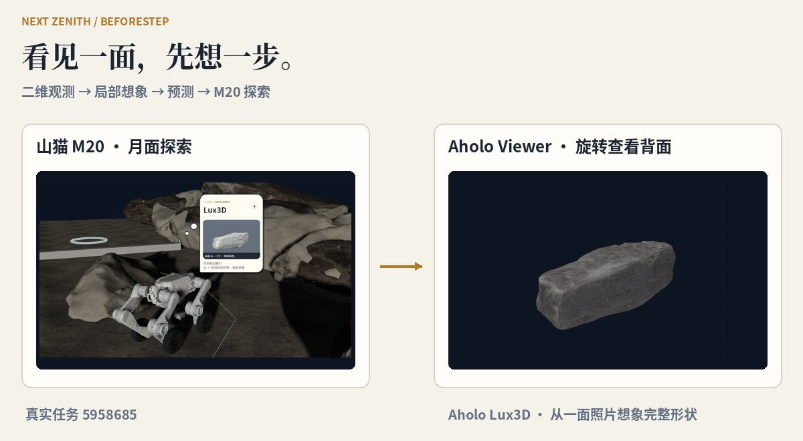
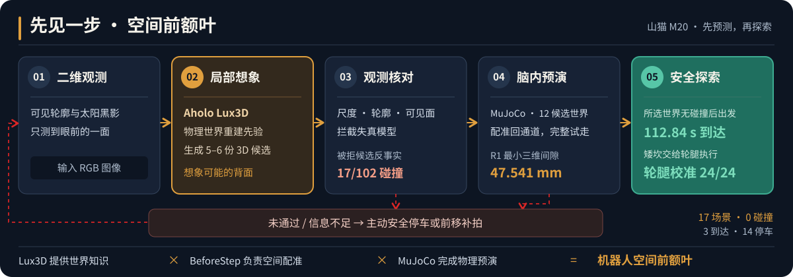
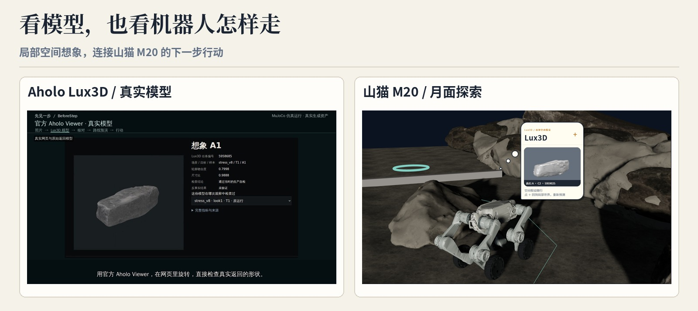
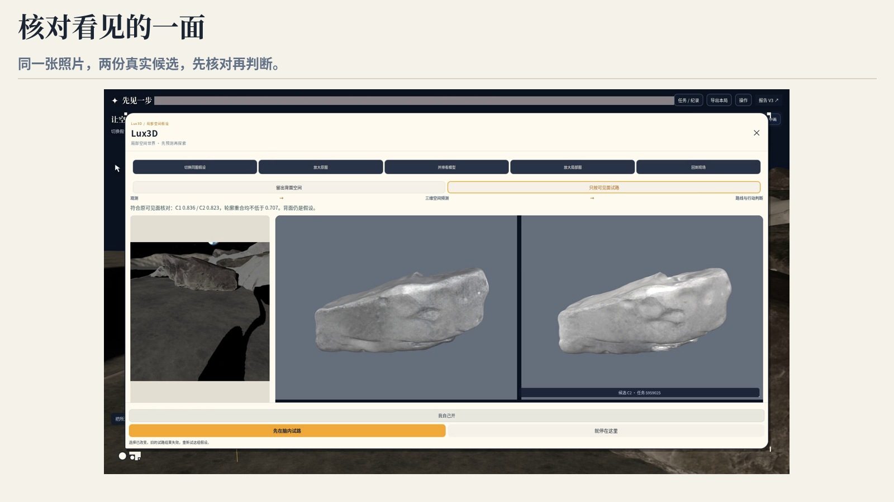
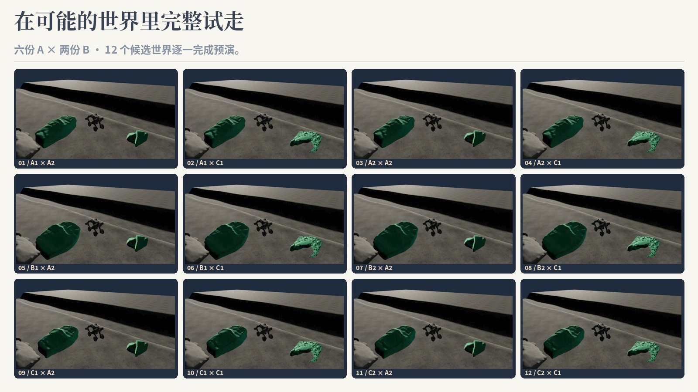
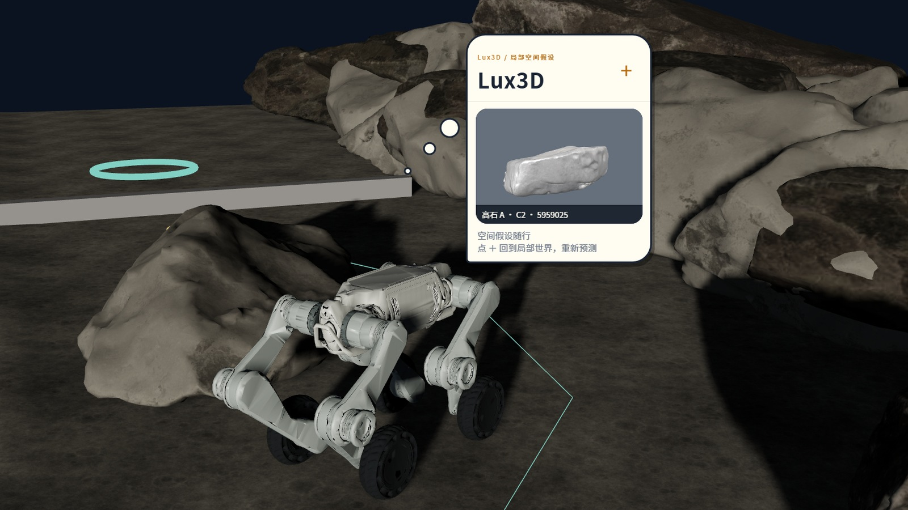
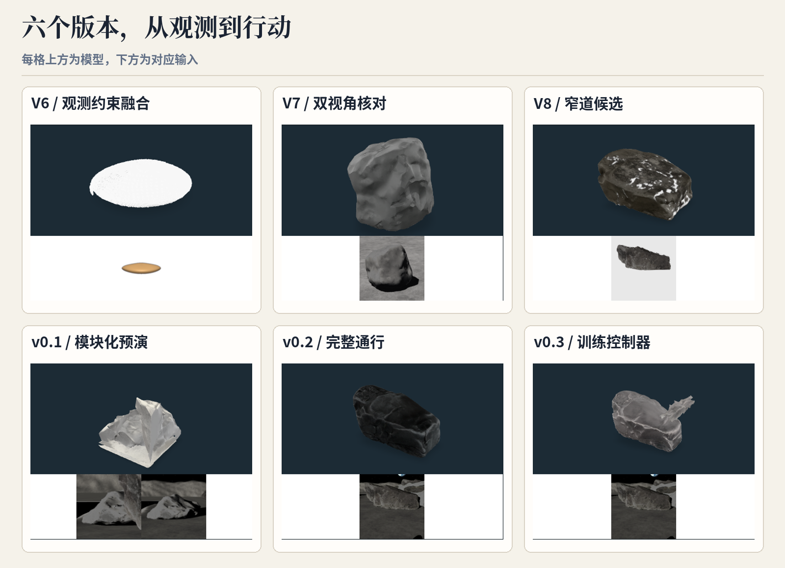

<div align="center">
  
  <p><sub>NEXT ZENITH · AHOLO HACKATHON</sub></p>
  <h1>先见一步 · BeforeStep</h1>
  <p><b>给山猫 M20 轮腿机器人装上“空间前额叶”：以 Aholo Lux3D 三维先验构建局部世界模型，先预测、再探索。</b></p>
  <p>
    <a href="https://codezzzsleep.github.io/next-zenith-beforestep/play.html"><b>在线四站试玩</b></a> ·
    <a href="https://www.bilibili.com/video/BV1YZst6eEZk/">B 站主宣传片</a> ·
    <a href="https://codezzzsleep.github.io/next-zenith-beforestep/report.html">主报告 V5 Beta</a><br>
    <a href="https://codezzzsleep.github.io/next-zenith-beforestep/">作品首页</a> ·
    <a href="https://github.com/codezzzsleep/next-zenith-beforestep/releases/tag/judges-demo-20261118">下载原片</a> ·
    <a href="docs/code-tour.md">代码导览</a>
  </p>
  <a href="https://www.bilibili.com/video/BV1YZst6eEZk/">
    
  </a>
  <p><sub>云深处山猫 M20 · 从二维观测到 Lux3D 空间想象 · 点击观看主宣传片</sub></p>
</div>

一面照片，多个可能的背面。BeforeStep 用真实 Lux3D 返回的三维形状构建可检验的局部世界，让轮腿机器人先判断、先试路，再决定前进、补看或停下。

**高石靠空间想象支持绕行，可见矮坎靠轮腿跨越。** 生成模型的形状、占地实际参与路线与碰撞计算；原输入、被拒候选、执行结果与核心版本全部保留。[完整故事](docs/submission-story-20261117.md) · [本轮事实与来源核查](docs/narrative-evidence-20261119.md) · [当前交付](docs/current-status.md)。

## 一、从事实出发：只看到一面，怎样判断下一步？

人能借助透视、遮挡和相对大小等线索，从二维图像推断空间；被挡住的背面仍可能有多种形状。[OpenStax Psychology 2e §5.3](https://openstax.org/books/psychology-2e/pages/5-3-vision) 介绍这些单眼线索，[PSSNet 形状补全研究](https://proceedings.mlr.press/v155/saund21a.html) 展示不完整观测下的多种合理几何假设。

当前月面仿真采用 **10° 低斜阳与部分深度缺失**设定。高石的背面占地影响通道能否通过：原 R1 乐观策略 **80.87 秒碰撞**，保守策略 **142.20 秒停车**，生成候选加完整预演的策略 **112.84 秒到达**。恢复黑影深度的对照也到达，这个结果说明本场景中空间假设的作用。

另一类困难来自轮子的执行能力：在 **10、12、15 cm 三个离散高度**的校准测试中，常规与高姿态轮行 **0/90** 通过，逐轮跨越 **24/24** 干净通过。高石需要判断未知形状；已经看清的矮坎需要用腿迈过去。[R1 原结果](docs/reviews/RESULT_BEFORESTEP_R1.md) · [轮腿校准与边界](docs/reviews/RESULT_WHEELLEG_CROSSING_FINAL.md)。

## 二、双线交汇：Lux3D 怎样成为“空间前额叶”？

[群核科技发布稿（2026-08-27）](https://www.prnewswire.com/news-releases/manycore-tech-unveils-lux3d-and-an-explicit-3d-path-to-world-models-302861778.html) 说明 Lux3D 混合使用生成数据与物理世界重建数据训练，以提升几何和视觉一致性，并介绍其显式三维世界模型路线。[World Labs](https://worldlabs.ai/blog/marble-world-model) 也将重建、生成和仿真三维世界纳入世界模型语境。

BeforeStep 把这份**三维先验**接入机器人局部建模：Lux3D 生成物体几何，已有 RGB-D、位姿与地形提供尺度和配准依据，系统核对可见部分并计算路线，MuJoCo 计算运动和接触。“空间前额叶”是这个内部想象与行动预测模块的比喻。

<picture>
  <source media="(max-width: 600px)" srcset="docs/assets/forebrain-pipeline-mobile.svg">
  
</picture>

**Lux3D 接收普通 RGB 图片**，接口无需上传深度图；本项目的完整链路仍使用深度辅助配准与核对。当前试玩复用已有真实候选；原 R1 的六份 A × 两份 B 组成 **12 个世界**，当前试玩初始 **1 世界**、同图对比 **2 世界**，分别计数。[官方 OpenAPI](https://labs.aholo.ai/api-docs/specifications/services/lux3d/openapi.en.json) · [研究与当前游戏代码导览](docs/code-tour.md)。

## 三、核心实证：保留成功，也保留自我推翻

| 实验阶段 | 核心指标 | 结果怎样解读 |
| --- | --- | --- |
| **R1 窄道对比** | 乐观 80.87 s 碰撞 · 保守 142.20 s 停车 · **112.84 s 到达**；12 世界完整预演 | 一次观察后的空间假设支持绕行；最小三维间隙 47.541 mm，二维矩形包络间隙为 0 mm，成功边界较窄。 |
| **核对与背面偏差** | 被拒候选反事实 **17/102 碰撞**；准入候选 **23/64** 背面短超过 5 cm | 正面吻合不保证未知背面正确，核对和完整预演通过后仍可能发生实际碰撞。 |
| **收紧未知区规则** | 已知 12 场 **3 到达 / 9 停车 / 0 碰撞**；留出 5 场 **0 到达 / 5 停车 / 0 碰撞** | 最终修订降低碰撞，同时牺牲通行；原方法和早期修订的碰撞继续保留。 |
| **轮腿执行能力** | 轮行 **0/90** · 逐轮跨越 **24/24**；真石 3/3 | 只适用于 10、12、15 cm 三个离散高度及冻结轮腿仿真条件。 |
| **推翻低石生成路线** | 六轮低门槛生成开发 **7/53 准入** | 已知可见矮坎由轮腿执行；原十二场正式门槛测试已取消，开发准入率与通行成功率分别记录。 |

表中秒数为原实验的**仿真时钟**。核对、预演与独立执行分别有记录；这些受控实验尚未证明普遍安全收益、任意环境探索或实机能力。[R1](docs/reviews/RESULT_BEFORESTEP_R1.md) · [R2](docs/reviews/RESULT_BEFORESTEP_R2.md) · [R3](docs/reviews/RESULT_BEFORESTEP_R3.md) · [每个数字的来源与范围](docs/narrative-evidence-20261119.md)。

## 看模型，也看 M20 怎样走

<picture>
  <source media="(max-width: 600px)" srcset="docs/readme/m20-bright-20261119/model-action-mobile.jpg">
  
</picture>

[**模型陈列室**](https://codezzzsleep.github.io/next-zenith-beforestep/gallery.html) 可以旋转真实返回的 GLB，查看任务和核对信息；[**M20 探索演示**](https://codezzzsleep.github.io/next-zenith-beforestep/#demo) 展示机器人预演之后的独立行动。照片、生成模型与 M20 的探索，在同一条推理链路里相遇。

<details>
<summary><b>展开证据：可见面核对、完整十二世界与 M20 行动</b></summary>

### 01 / 核对看见的一面



同字节原图的任务 5958654 通过核对，5958642 被拒。冻结轮廓门槛为 0.7068，原测量与拒绝原因保持。

### 02 / 在可能的世界里完整试走



六份 A × 两份 B；四乘三十二格使用现有 M20 外观，逐一展示完整预演中的候选世界。

### 03 / 让 M20 选择下一步行动



从观测、空间想象到探索，每一步都支持你的行动选择。[来源、任务与 SHA-256](docs/readme/m20-bright-20261119/sources.json) 可逐项核对。

</details>

**统计口径：累计 491 创建 / 460 成功 GLB / 31 失败**，来自 [production-v6/facts.json](evidence/production-v6/facts.json) 的 `lux.live_ledger_counts`；**V5 Beta 归档节点 467 / 438 / 29** 来自 [route/lux-usage.json](evidence/crossing/route/lux-usage.json)。任务、预演世界和游戏局数分别计数。

## 四、在线四站试玩：观测 → 局部想象 → 预测 → 探索

**穿过高石，跨过矮坎，在青色信标里停稳。** [打开四站试玩](https://codezzzsleep.github.io/next-zenith-beforestep/play.html)，按 Enter 开始。四站是同一月面任务中的四个交互阶段。

<a href="https://codezzzsleep.github.io/next-zenith-beforestep/play.html">
  
</a>

1. **观测与初判。** 驾驶到高石观察点，停稳、切到第一视角，留下“能过”“绕开”或“拿不准”。
2. **局部想象。** 初判后自主选择手控、Lux3D 想象、现场补看或停车；按 Q 对比原图、真实候选与配准占地。
3. **预测与选择。** 从当前停稳位置完整预演所选全部世界，核对路线能否走完，再决定是否辅助出发；方向键随时接管。
4. **探索与跨越。** 绕过高石，看清矮坎，亲手触发四腿的 12 个主要动作，再回到轮行驶入信标。

| 操作 | 按键 | 作用 |
| --- | --- | --- |
| 开始、驾驶与刹车 | Enter；WASD / 方向键；空格 | 在同一个物理世界中驾驶与停稳 |
| 空间想象 / 现场补看 | Q / E | 查看已有候选，或采集本局真实射线命中的新表面 |
| 切换视角 | V | 第一、第三与俯视共用同一实时快照 |
| 逐腿跨越 | 1–4；J / K / L | 选腿，再抬起、前移、落地 |
| 探索练习继续 | R | 回到本局实际停稳检查点 |

**手控独立开放**；辅助路线必须通过预演，许可绑定候选、路线、停稳姿态和本局观测版本。有效补看或改变选择会撤销旧许可。探索练习支持检查点继续，全程挑战另记成绩。

试玩使用[云深处山猫 M20 公开外观模型](https://github.com/DeepRoboticsLab/deep_robotics_model/tree/main/M20)，运动与接触由浏览器中的 MuJoCo 3.17 轮腿仿真计算，保留既有 16 个执行器与控制器。支撑和平衡由控制器辅助，主要跨越动作由玩家触发。桌面与 390 px 触屏模拟已完成整局，手机真机性能尚未测量。

[操作与实现](docs/mission.md) · [练习、挑战与成绩](docs/playability.md) · [真实试玩验收](docs/judges-demo.md) · [加载方式](docs/startup-loading.md)。

## 六个版本，留下每一步的证据

从 V6、V7、V8 到 v0.1、v0.2、v0.3，关键输入、模型、源码、配置与结果都保留在本仓库。图中每格上方是模型，下方是对应输入；手机使用两列排版，可以逐格查看。

<a href="https://codezzzsleep.github.io/next-zenith-beforestep/award-assets.html">
  <picture>
    <source media="(max-width: 600px)" srcset="docs/readme/m20-showcase/versions-mobile.png">
    
  </picture>
</a>

| 版本 | 这一阶段增加什么 | 保留的结果与边界 |
| --- | --- | --- |
| V6 | 用观测约束融合几何 | 可见区域得到修复，未知背面仍未证明 |
| V7 | 双视角与冻结候选核对 | 不同视角并不一定改善生成形状 |
| V8 | 候选进入极地窄道决策 | 第二块石头候选全拒，原任务停车 |
| v0.1 | 模块化检查、完整预演与规范终态 | 原两图重试仍被拒；工程改进有独立记录 |
| v0.2 | 在有效关口完成整条链路 | 真实 Lux3D 分支到达；直接走对照也到达 |
| v0.3 | 训练模型控制与生成几何改路 | 训练控制器完成独立执行；失败和消融保留 |

**报告 V5 Beta 与这些技术版本分别编号。** v0.3.0 的历史发布、原附件与源提交继续保留；原 R1 研究采用冻结规则控制，试玩使用原动力学上的独立交互层。

[交互资产对比](https://codezzzsleep.github.io/next-zenith-beforestep/award-assets.html) · [技术里程碑](docs/milestones.md) · [核心资产与版本清单](evidence/award/asset-iterations/manifest.json) · [资产总索引](assets/manifest.json)。

## 报告、影片与剪辑素材

| 材料 | 当前入口 |
| --- | --- |
| **主报告 V5 Beta · 11 页** | [逐页阅读](https://codezzzsleep.github.io/next-zenith-beforestep/report.html) · [原 PDF](reports/v5-beta/report.pdf) · [报告版本与原文件](reports/README.md) |
| **B 站主宣传片** | [作者已发布的视频](https://www.bilibili.com/video/BV1YZst6eEZk/)（BV1YZst6eEZk） |
| **连续 1080p 原片与补拍** | [固定 Release 下载](https://github.com/codezzzsleep/next-zenith-beforestep/releases/tag/judges-demo-20261118) · [母片、五图、时间码与研究索引](evidence/judges-demo/README.md) |
| 导演剪辑素材指南 | [112 秒成片的原素材与镜头顺序](docs/demo-edit-guide.md) |
| 历史影片与报告 | [185 秒完整作品 Demo](evidence/production-v6/README.md) · [Lux3D 配乐版](evidence/lux3d-demo-v2/README.md) · [V3/V4 原报告](reports/README.md) |

母片是约 5 分钟的连续原速仿真录制，另有清楚的模型/地图补拍、停车分支与五张图。最终 112 秒配音、音乐与字幕成片由导演制作；[原片目录](evidence/judges-demo/README.md) 记录实际交付与下载核验范围。

累计账本为 **491 创建 / 460 成功 GLB / 31 失败**；V5 Beta 原稿中的 **467 创建 / 438 成功 / 29 失败**属于较早的归档节点。两组身份与统计分别保留，公开介绍统一为“累计 491 个真实任务（V5 Beta 归档 467 个）”。[原统计](evidence/production-v6/facts.json) · [V5 Beta 原件与配套说明](reports/v5-beta/README.md)。

## 五、本地复现：复用已生成资产

浏览器试玩不需要 API 密钥；冻结研究链路可通过 `--reuse-lux` 复用真实资产，无新增云端生成费用。两条启动方式与所需 Git LFS 资源分别列明：

<details>
<summary><b>展开浏览器试玩、冻结研究链路与依赖</b></summary>

### 浏览器试玩

在线体验直接[打开月面探索](https://codezzzsleep.github.io/next-zenith-beforestep/play.html)。本地使用同一份已生成资产：

```bash
GIT_LFS_SKIP_SMUDGE=1 git clone --depth 1 https://github.com/codezzzsleep/next-zenith-beforestep.git
cd next-zenith-beforestep
git lfs install --local
git lfs pull --include="site/**" --exclude=""
python3 -m http.server 8000 --bind 127.0.0.1
```

打开 <http://127.0.0.1:8000/site/play.html>。浏览器试玩复用已有真实模型，不需要 API 密钥，也不创建新的生成任务。

### 冻结 R1 研究链路

需要 **Python 3.12、Git LFS 与可用的 MuJoCo OpenGL 环境**。在同一仓库继续拉取研究资产、安装依赖：

```bash
git lfs pull --include="assets/runtime-*.tar.gz,assets/candidates/595*/tex_mesh.glb,evidence/reviews/beforestep_r1/lux/original_b/**,evidence/web-assets/**" --exclude=""
./setup.sh
MUJOCO_GL=egl .venv/bin/python ops/quickstart.py --reuse-lux --serve
```

命令完成冻结 R1 的观测、自检、十二世界完整预演与独立执行，随后在 <http://127.0.0.1:8080> 提供本地作品页。实际耗时随设备变化；[逐步命令、源码与输出位置](docs/code-tour.md) 可用于复查。

<details>
<summary><b>依赖与更多历史素材</b></summary>

Ubuntu/Debian 缺少 `venv` 时，安装与 Python 3.12 对应的 `python3.12-venv`。视频与部分大型模型使用 Git LFS，按需拉取历史影片：

```bash
git lfs pull --include="evidence/lux3d-demo-v2/**,evidence/production-v6/film/**" --exclude=""
```

当前 1080p 原片通过上表的固定 Release 下载。V5 Beta 原 PDF 随仓库保存；[报告索引](reports/README.md) 解释各版文件的来源。

全新克隆的历史验收记录在 [C5-fresh.json](evidence/award/acceptance/C5-fresh.json)，其设备与阶段不代表每台机器的当前耗时。控制、训练与 Arena 的研究作为独立附录保留。

</details>


</details>

## 源码、复现与来源

<p>
  
  
  
</p>

| 目录 / 资料 | 内容与入口 |
| --- | --- |
| [site/](site/) | 当前浏览器游戏、物理 Worker、观测、规划与交互；[代码导览](docs/code-tour.md) |
| [src/beforestep/](src/beforestep/) | 原研究的观测、生成、配准、自检、规划、预演与执行 |
| [assets/](assets/) · [evidence/](evidence/) | 原输入、生成网格、资产身份、失败、独立运行与版本证据 |
| [reports/](reports/) · [tools/](tools/) | V5 Beta / V3 / V4 原报告、影片制作与可复现构建工具 |
| [完整参赛故事](docs/submission-story-20261117.md) | 项目为什么做、Lux3D 怎样参与，以及[事实来源](docs/submission-story-sources-20261117.md) |
| [项目目标](docs/project.md) · [交付决策](docs/decisions.md) | 当前能力、版本选择、证据保留与[参赛材料核对](docs/hackathon-submission.md) |
| [来源与致谢](docs/credits.md) | 模型、扫描岩石、物理引擎与字体；[相关研究](docs/related-work.md) · [参考文献](docs/references.bib) |
| [README 图文说明](docs/readme/README.md) | GIF、原片、拼版、手机排版、源 SHA 与重制方法 |

本仓库完整提供源码与参赛材料，版本复查依赖这里保留的文件与证据。私有凭据与运行记忆保存在公开仓库之外。

<p align="center"><sub>Next Zenith · 先见一步 BeforeStep</sub></p>
