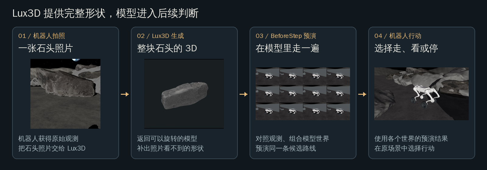
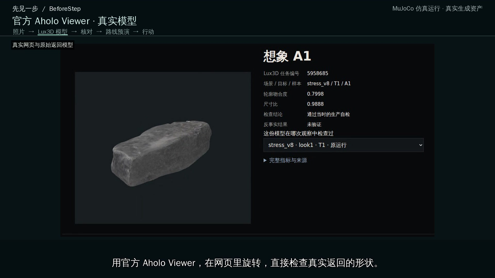
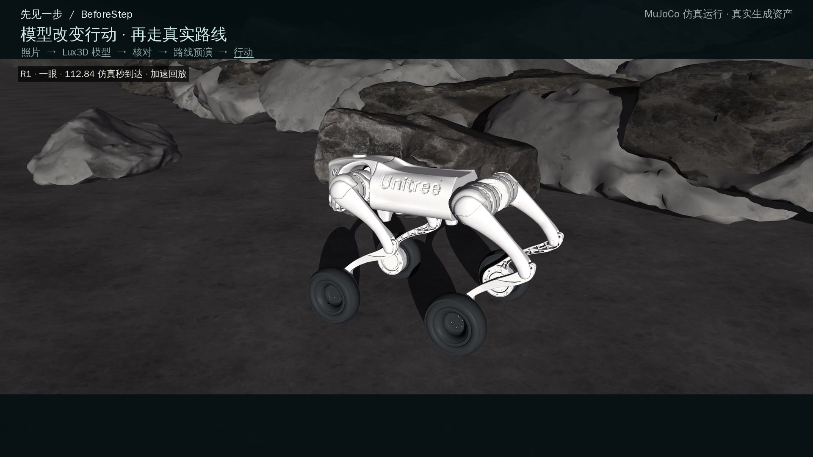
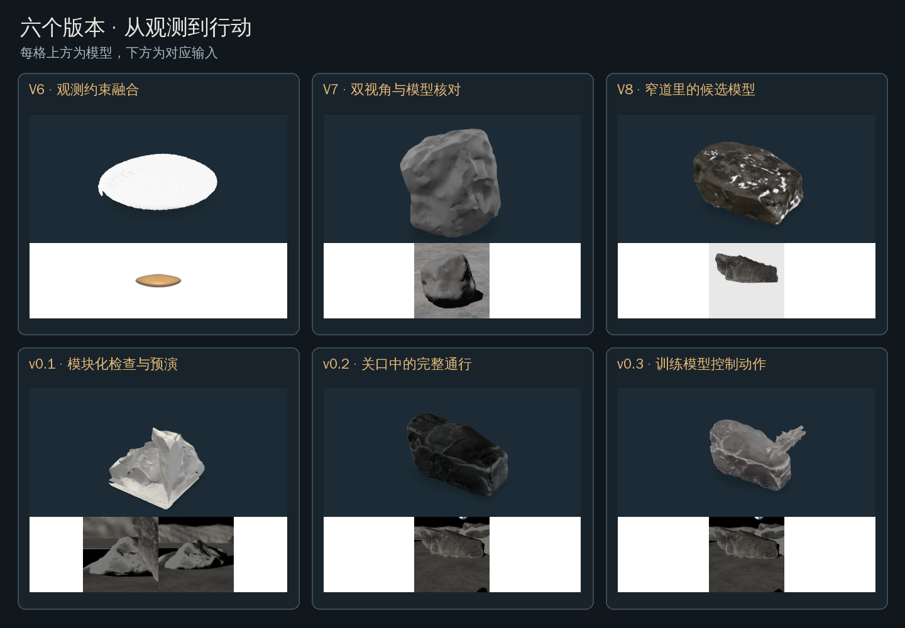

<div align="center">
  
  <h1>先见一步 · BeforeStep</h1>
  <p><b>给机器人空间想象：从有限观测预测局部空间，先判断，再探索。</b></p>
  <p>
    
    
    
  </p>
  <p>
    <a href="https://codezzzsleep.github.io/next-zenith-beforestep/play.html">亲自驾驶机器人</a> ·
    <a href="https://codezzzsleep.github.io/next-zenith-beforestep/">作品首页</a> ·
    <a href="https://b23.tv/4CAPaLu">B站主宣传片</a> ·
    <a href="site/media/report.pdf">主报告 V3</a> ·
    <a href="#快速开始">快速开始</a> ·
    <a href="docs/code-tour.md">代码导览</a>
  </p>
  <a href="https://b23.tv/4CAPaLu">
    
  </a>
  <p><sub>原始照片 → 对应 Lux3D 模型 · 点击观看作者已发布的 B站主宣传片</sub></p>
</div>

BeforeStep 是 Next Zenith 的月面轮腿机器人仿真作品。它利用 **Lux3D 构建可检验的局部空间世界模型，为机器人增加空间想象能力**：从有限观测预测未见的几何，结合观测核对与 MuJoCo 预演判断行动后果，再执行探索。我们把这个模块比喻成机器人的前额叶。岩石是已验证的局部实例，候选几何放回通道后实际参与占地、路线和碰撞计算。

作品中**真实调用 Lux3D 四百多次**。生成模型进入实际判断，也通过**官方 Aholo Viewer** 展示在网页中：你可以查看原照片、旋转模型，再看机器人怎样走。

## 这次，你来开机器人

[打开月面探索](https://codezzzsleep.github.io/next-zenith-beforestep/play.html)，一键开始任务：“穿过石缝，跨过矮坎，在青色信标里停稳。”先从第三视角自己驾驶，使用 **WASD / 方向键**与**空格刹车**。高石观察点自动停稳、切到当前第一视角，留下自己的初判，再选择手控、空间想象、补看或停车。按 **Q** 主动展开同一张原 RGB 图、真实 Lux3D 候选、配准占地与两条规划路线；完整试路只为辅助出发提供许可，手控在初判后独立开放。**E** 补看把确实测到的新表面带回本局图层，**V** 切视角。越过高石后才揭晓背面；可见矮坎前等车停稳、对正，用 **1–4**、**J 抬起 / K 前移 / L 落地**亲手完成 12 个主要动作，再回轮行驶入信标。手机使用摇杆与对应按钮。

浏览器使用 **MuJoCo 3.17 实时计算物理状态**，轮腿电机驱动机器人；无需安装 Python、配置密钥或调用新的生成任务。辅助路线须从当前停稳状态通过所选模型世界的实际预演，手控可随时接管；重心与支撑由控制器辅助。游玩成绩与原研究结果分别记录。[当前评审试玩与原片来源](docs/judges-demo.md) · [1080p原片、五图与固定下载](evidence/judges-demo/README.md) · [前版体验验证](docs/spatial-imagination-game-20261118.md) · [实现、来源与本地运行](docs/mission.md) · [既有完整实录](evidence/showcase-guided-20261116/README.md)。

探索练习提供高石观察点、门槛前和跨越后的实际停稳检查点。全程挑战从起点一次完成，争取勘察印记与个人纪录；还可以换一组已有真实模型再试。局内成绩只保存在本机，与原研究结果及赛事评分分别计数。 新的[评审试玩流程与原片来源](docs/judges-demo.md)从初判开始，支持自主手控、空间想象、现场补看和停车。宣传以作者已发布的 [B站视频](https://b23.tv/4CAPaLu) 为主，报告以 [V3 原稿](site/media/report.pdf) 为主；[V4 补充报告与构建源](reports/v4/README.md)继续保留。

脑内窗口并排展示原照片与候选，俯视图呈现可见占地、背面假设和两条规划路线；完成卡回顾本局选择、预演与执行。[空间判断体验与验证](docs/spatial-judgment.md)。

启动使用 Cloudflare 分段读取、已核对资源缓存及真实下载进度，线路故障可回退原资源。[加载说明与验证](docs/startup-loading.md)。

## 从照片到行动

<p align="center">
  
</p>

一张照片可以生成多份完整形状。BeforeStep 把它们与看得见的那面核对，再将通过核对的模型组合成不同的世界，让同一台机器人在每个世界里**走完同一条候选路线**。预演结果支持执行时，才回到原场景迈步；需要更多信息时，补看或停车。

R1 窄道中，六份石头 A 模型与两份石头 B 模型组成 **12 个世界**。机器人在全部组合里完成路线预演，随后用一次观测完成原场景绕行。

## 看模型，也看机器人怎么走

<table>
  <tr>
    <td width="50%"><a href="https://codezzzsleep.github.io/next-zenith-beforestep/gallery.html"></a></td>
    <td width="50%"><a href="https://codezzzsleep.github.io/next-zenith-beforestep/#demo"></a></td>
  </tr>
  <tr>
    <td align="center"><sub><b>模型陈列室</b> · 旋转查看 Lux3D 返回的形状</sub></td>
    <td align="center"><sub><b>机器人行动</b> · 看预演之后的实际绕行</sub></td>
  </tr>
</table>

同一条 R1 窄道里的三种选择，对应三种实际结果：

| 策略 | 观察次数 | 运行结果 |
| --- | --- | --- |
| 直接走 · 乐观策略 | 1 眼 | 80.87 秒碰撞 |
| 看清再走 · 保守策略 | 5 眼 | 142.20 秒停车 |
| 想一想再走 · Lux3D + 预演 | 1 眼 | **112.84 秒到达** |

时间为该场原运行的仿真时钟。完整对照见 [R1 执行记录](docs/reviews/RESULT_BEFORESTEP_R1.md)；更多场景可打开[关卡回放](https://codezzzsleep.github.io/next-zenith-beforestep/levels.html)和[同路两种石头](https://codezzzsleep.github.io/next-zenith-beforestep/crossing.html)。

## 快速开始

直接[打开作品主页](https://codezzzsleep.github.io/next-zenith-beforestep/)即可看模型与 Demo。本地运行需要 **Python 3.12、Git LFS 和 MuJoCo 的 OpenGL 渲染环境**；以下命令复用仓库中的真实 Lux3D 资产，不需要 API 密钥。

```bash
GIT_LFS_SKIP_SMUDGE=1 git clone --depth 1 https://github.com/codezzzsleep/next-zenith-beforestep.git
cd next-zenith-beforestep
git lfs install --local
git lfs pull --include="assets/runtime-*.tar.gz,assets/candidates/595*/tex_mesh.glb,evidence/reviews/beforestep_r1/lux/original_b/**,site/**,evidence/web-assets/**" --exclude=""
./setup.sh
.venv/bin/python ops/quickstart.py --reuse-lux --serve
```

Ubuntu/Debian 缺少 `venv` 时，先安装 `sudo apt-get install python3.12-venv`。命令完成观测、自检、12 个世界的完整物理预演与独立执行后，在 <http://127.0.0.1:8080> 打开本地作品页。

<details>
<summary><b>运行耗时与资源下载</b></summary>

全新克隆实测，安装与启动约 104 秒，完整仿真另耗时约 21 分钟；耗时随设备变化。原记录见 [C5-fresh.json](evidence/award/acceptance/C5-fresh.json)。

视频、报告和大型模型使用 Git LFS 保存。按需下载最新版视频与报告：

```bash
git lfs pull --include="evidence/lux3d-demo-v2/**" --exclude=""
```

下载全部历史二进制资料：

```bash
git lfs pull --include="" --exclude=""
```

六步源码入口、独立命令和输出位置见[代码导览](docs/code-tour.md)。

</details>

## 技术与资产迭代

从 V6、V7、V8 到 v0.1、v0.2、v0.3，项目逐步加入观测约束、候选核对、完整路线预演与独立执行。每个核心版本保留输入、生成资产、源码和运行结果，可以按版本比较。

<details>
<summary><b>展开查看六个版本的输入与 3D 模型</b></summary>

<p align="center">
  <a href="https://codezzzsleep.github.io/next-zenith-beforestep/award-assets.html"></a>
</p>

[交互资产对比](https://codezzzsleep.github.io/next-zenith-beforestep/award-assets.html) · [技术里程碑](docs/milestones.md) · [核心资产清单](evidence/award/asset-iterations/manifest.json)

</details>

## 源码与资料

| 你想看什么 | 从这里进入 |
| --- | --- |
| 观测 → 生成 → 核对 → 预演 → 执行的代码 | [五分钟代码导览](docs/code-tour.md) · [src/beforestep](src/beforestep/) |
| 完整参赛故事与事实来源 | [从照片到局部空间的完整故事](docs/submission-story-20261117.md) · [事实核查与原始来源](docs/submission-story-sources-20261117.md) |
| 主宣传视频与主报告 | [B站主宣传片](https://b23.tv/4CAPaLu) · [主报告 V3](site/media/report.pdf) · [完整 Demo 存档](evidence/lux3d-demo-v2/README.md) |
| 历史视频与 v3 报告一起下载 | [视频与 v3 报告 ZIP](https://media.githubusercontent.com/media/codezzzsleep/next-zenith-beforestep/ab537d62c075c4d7be1e829cecb69a4708258221/evidence/lux3d-demo-v2/BeforeStep-Lux3D-v2-submission.zip) |
| 视频怎样制作 | [原 Demo 合成代码](tools/lux3d_demo/README.md) · [配乐与过渡代码](tools/lux3d_demo_v2/README.md) |
| 原始输入、生成模型与实验数据 | [assets](assets/) · [evidence](evidence/) · [R1](docs/reviews/RESULT_BEFORESTEP_R1.md) · [R2](docs/reviews/RESULT_BEFORESTEP_R2.md) · [R3](docs/reviews/RESULT_BEFORESTEP_R3.md) |
| 完整故事版与 39 条镜头素材 | [production-v6](evidence/production-v6/README.md) · [制作代码](tools/production_v6/README.md) |
| README 图片与 GIF 的来源 | [图文素材说明](docs/readme/README.md) |
