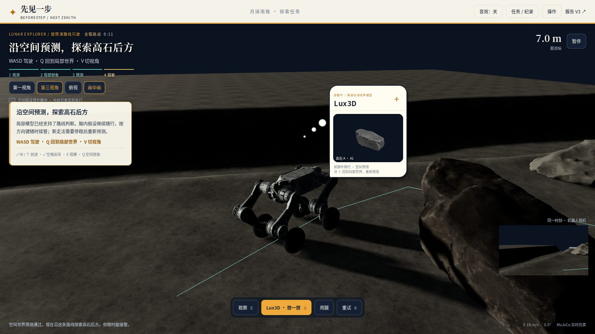
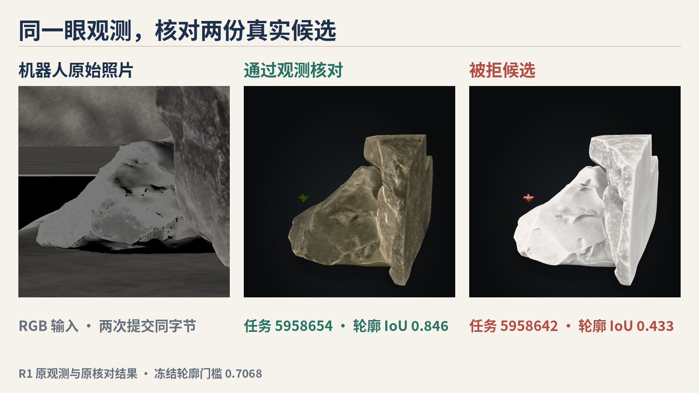
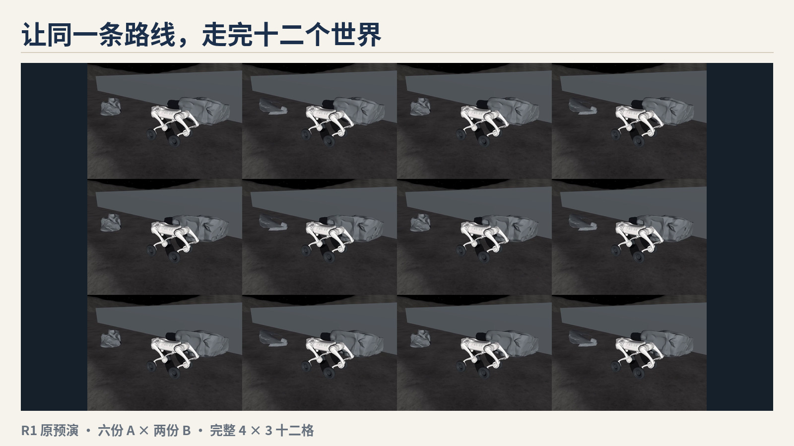

<div align="center">
  
  <h1>先见一步 · BeforeStep</h1>
  <p><b>给机器人空间想象：从有限观测预测局部空间，先判断，再探索。</b></p>
  <p>
    
    
    
  </p>
  <p>
    <a href="https://codezzzsleep.github.io/next-zenith-beforestep/play.html">开始月面探索</a> ·
    <a href="https://codezzzsleep.github.io/next-zenith-beforestep/report.html">主报告 V5</a> ·
    <a href="https://b23.tv/4CAPaLu">B站主宣传片</a> ·
    <a href="https://github.com/codezzzsleep/next-zenith-beforestep/releases/tag/judges-demo-20261118">下载 1080p 原片</a> ·
    <a href="docs/code-tour.md">代码导览</a>
  </p>
  <a href="https://codezzzsleep.github.io/next-zenith-beforestep/play.html">
    
  </a>
</div>

BeforeStep 是 Next Zenith 的月面轮腿机器人仿真作品。它用 **Lux3D 的图生三维能力构建局部空间假设**：把普通照片生成的几何与已有观测对齐、核对，再放回通道，规划路线并进行物理预演。生成模型的形状和占地实际参与机器人怎样前进的判断。我们把这个先想后走的模块比喻成机器人的前额叶。

Lux3D 输入是普通 RGB 图片；当前研究使用 RGB-D、位姿和已知地形辅助本地配准与核对。Lux3D 提供未见形状的静态假设，MuJoCo 计算行动后果。项目累计创建 **400 多次真实生成任务**，保留输入、原 GLB、任务身份、被拒候选与真实结果。[完整故事与来源](docs/submission-story-20261117.md) · [当前交付状态](docs/current-status.md)。

## 现在，你来开机器人

[打开月面探索](https://codezzzsleep.github.io/next-zenith-beforestep/play.html)，目标是穿过高石、跨过矮坎，在青色信标里停稳。浏览器运行 MuJoCo 3.17 物理与原轮腿电机控制，手机提供摇杆和对应按钮。

| 操作 | 桌面 | 作用 |
| --- | --- | --- |
| 开始与驾驶 | Enter；WASD / 方向键 | 从第三视角出发，靠近高石观察点 |
| 刹车 | 空格 | 电机制动，保持当前物理状态 |
| 留下初判 | 观察点按钮 | 选择“能过”“绕开”或“拿不准” |
| 空间想象 | Q | 看同一原图的两份真实候选、配准占地和路线 |
| 补充观察 | E | 将本局真实射线测到的新表面带回地图 |
| 切换视角 | V | 第一、第三和俯视消费同一实时快照 |
| 轮腿跨越 | 1–4；J / K / L | 选腿，再分别抬起、前移、落地 |
| 探索练习继续 | R | 回到本局实际停稳检查点 |

观察点保留自然遮挡与完整原贴图。留下初判后，你可以**自己开、让 Lux3D 想一想、再看一眼或停车**。完整预演为辅助路线提供许可；手控独立开放。辅助许可绑定所选世界、路线、停稳起点和本局观测版本，途中可以接管。

默认评审体验使用同图两份 A 候选和固定 B 候选组成 **2 个世界**。原 R1 研究的 **12 个世界**另行保留。门槛前可以试轮行、直接迈腿或先预演，再亲手触发四腿的 12 个主要动作。M20 是试玩外观，原研究使用 Go2W 条件；游玩成绩与 R1/R2/R3 分开记录。

[操作与实现](docs/mission.md) · [练习、挑战与成绩](docs/playability.md) · [当前试玩验收](docs/judges-demo.md)。

## 从照片到行动，三步都有原证据

<table>
  <tr>
    <td width="33%"><a href="site/media/home-evidence-20261118/01-observation-and-candidates.jpg"></a></td>
    <td width="34%"><a href="site/media/home-evidence-20261118/02-twelve-world-rehearsals.jpg"></a></td>
    <td width="33%"><a href="site/media/home-evidence-20261118/03-three-real-outcomes.jpg"></a></td>
  </tr>
  <tr>
    <td><b>01 / 核对看见的一面</b><br>同一眼原图返回不同候选；保留吻合的模型，也记录拒绝原因。</td>
    <td><b>02 / 在可能世界里试走</b><br>六份 A × 两份 B，让同一条路线走完十二个世界。</td>
    <td><b>03 / 选择下一步行动</b><br>预演支持行动；独立原运行保留到达、停车与碰撞。</td>
  </tr>
</table>

三图均为 1600×900，完整保留原图画面比例。点击可看大图；[原始来源、任务、时间码与 SHA-256](site/media/home-evidence-20261118/sources.json)可逐项复查。

| R1 同一窄道的策略 | 观察次数 | 原运行结果 |
| --- | --- | --- |
| 直接走 · 乐观 | 1 眼 | 80.87 秒碰撞 |
| 看清再走 · 保守 | 5 眼 | 142.20 秒停车 |
| 想一想再走 · Lux3D + 完整预演 | 1 眼 | **112.84 秒到达** |

时间是原运行的仿真时钟。模型符合可见观测、预演通过，仍可能猜错背面。R2/R3 的原碰撞与收紧规则后的停车也公开保留；这些结果与新游戏成绩分别计数。[冻结 R1 记录](docs/reviews/RESULT_BEFORESTEP_R1.md) · [R2](docs/reviews/RESULT_BEFORESTEP_R2.md) · [R3](docs/reviews/RESULT_BEFORESTEP_R3.md)。

## 报告、视频与剪辑素材

| 材料 | 当前入口 |
| --- | --- |
| 主报告 V5 | [逐页阅读](https://codezzzsleep.github.io/next-zenith-beforestep/report.html) · [V5 原 PDF](reports/v5/report.pdf) · [版本与原文件](reports/README.md) |
| 主宣传片 | [作者已发布的 B站视频](https://b23.tv/4CAPaLu)（BV1aYsw6REh7） |
| 连续 1080p 母片与补拍 | [固定 Release](https://github.com/codezzzsleep/next-zenith-beforestep/releases/tag/judges-demo-20261118) · [原片、五图、时间码与研究索引](evidence/judges-demo/README.md) |
| 当前导演剪辑说明 | [112 秒成片的原素材指南](docs/demo-edit-guide.md) |
| 历史成片与报告 | [185 秒完整作品 Demo](evidence/production-v6/README.md) · [Lux3D 配乐版](evidence/lux3d-demo-v2/README.md) · [V3/V4 报告保留说明](reports/README.md) |

母片是约 5 分钟连续原速仿真录制，另有清晰模型/地图补拍、停车分支和五张图。它交付导演剪辑素材；最终 112 秒配音、音乐与字幕成片由导演制作。公开入口已通过桌面和 390px 触屏模拟整局验收，手机真机性能尚未测量。下载核验的实际范围见[原片交付记录](evidence/judges-demo/README.md)。

## 本地运行

在线试玩直接打开 `play.html`。本地浏览器试玩使用同一份已生成资产：

```bash
GIT_LFS_SKIP_SMUDGE=1 git clone --depth 1 https://github.com/codezzzsleep/next-zenith-beforestep.git
cd next-zenith-beforestep
git lfs install --local
git lfs pull --include="site/**" --exclude=""
python3 -m http.server 8000 --bind 127.0.0.1
```

打开 <http://127.0.0.1:8000/site/play.html>。浏览器试玩不要求 API 密钥，也不创建生成任务。启动资源使用分段读取、SHA 核验、缓存与原资源回退；[加载说明](docs/startup-loading.md)。

冻结 R1 的 Python 研究复现需要 Python 3.12 与可用的 MuJoCo OpenGL 环境，另外拉取研究资产并安装依赖：

```bash
git lfs pull --include="assets/runtime-*.tar.gz,assets/candidates/595*/tex_mesh.glb,evidence/reviews/beforestep_r1/lux/original_b/**,evidence/web-assets/**" --exclude=""
./setup.sh
MUJOCO_GL=egl .venv/bin/python ops/quickstart.py --reuse-lux --serve
```

这条命令完成冻结 R1 的观测、自检、十二世界预演与独立执行。完整仿真耗时随机器变化；[代码入口与输出](docs/code-tour.md)提供逐步说明。历史控制、训练与 Arena 作为独立研究附录保留。

## 技术与资产迭代

V6、V7、V8、v0.1、v0.2、v0.3 的关键源码、配置、输入、原模型、失败与结果均在本仓库保留。报告 V5 与这些技术版本分别编号；历史发布 v0.3.0 保留其当时的训练控制器与冻结附件。

[交互资产对比](https://codezzzsleep.github.io/next-zenith-beforestep/award-assets.html) · [技术里程碑](docs/milestones.md) · [核心版本资产清单](evidence/award/asset-iterations/manifest.json) · [资产总索引](assets/manifest.json)。

## 源码与证据入口

| 要核对的内容 | 从这里进入 |
| --- | --- |
| 本次可玩体验与运行状态 | [当前交付](docs/current-status.md) · [实时游戏代码导览](docs/code-tour.md) · [site/mission-worker.js](site/mission-worker.js) |
| 观测、生成、核对、规划、预演与执行 | [src/beforestep](src/beforestep/) · [研究代码导览](docs/code-tour.md) |
| 完整参赛故事与原始来源 | [完整故事](docs/submission-story-20261117.md) · [事实核查](docs/submission-story-sources-20261117.md) |
| 同路高石与低门槛的实际边界 | [四车原结果](evidence/crossing/route/summary.json) · [轮腿实验结论](docs/reviews/RESULT_WHEELLEG_CROSSING_FINAL.md) |
| 项目目的、版本选择与资料保留 | [项目目标](docs/project.md) · [决策](docs/decisions.md) · [提交材料核对](docs/hackathon-submission.md) |
| 许可证、扫描资产与引用 | [来源与致谢](docs/credits.md) · [相关研究](docs/related-work.md) · [参考文献](docs/references.bib) |

本仓库是源码与参赛材料的完整交付目标；旧 checkout 已移除，复查不依赖旧仓库。私有凭据与运行记忆保存在公开仓库之外。
