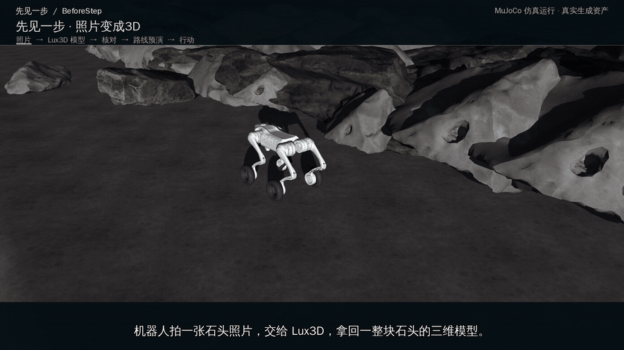
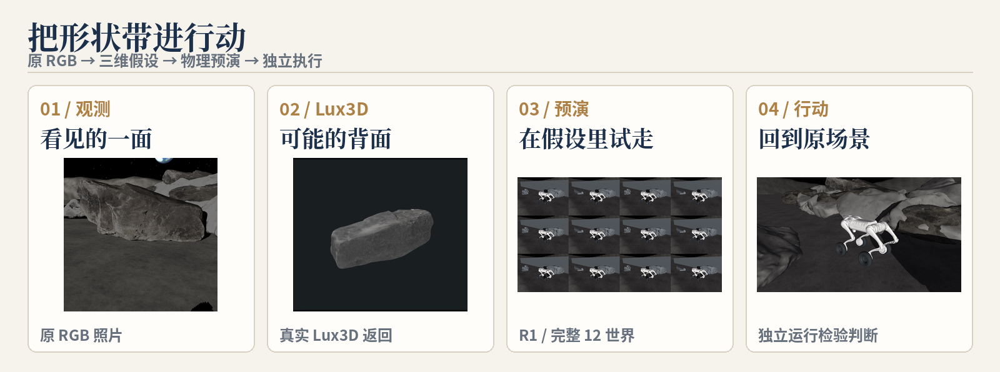
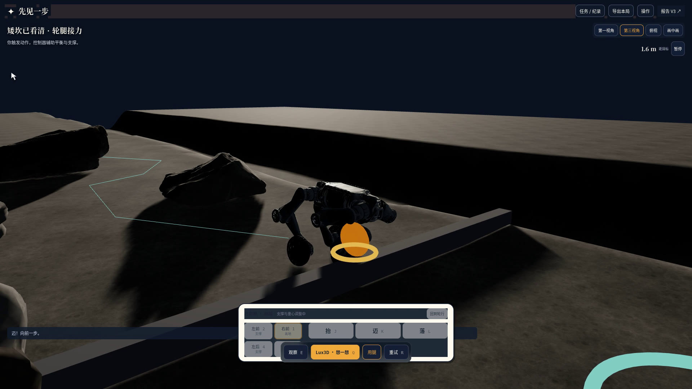
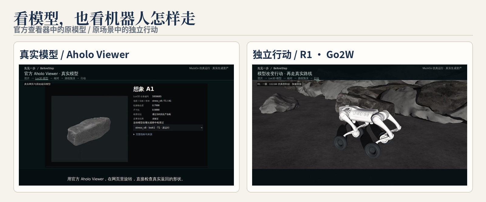
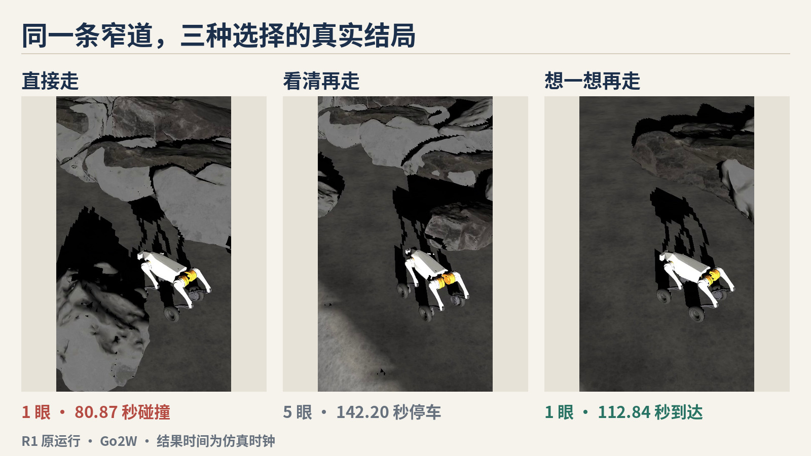
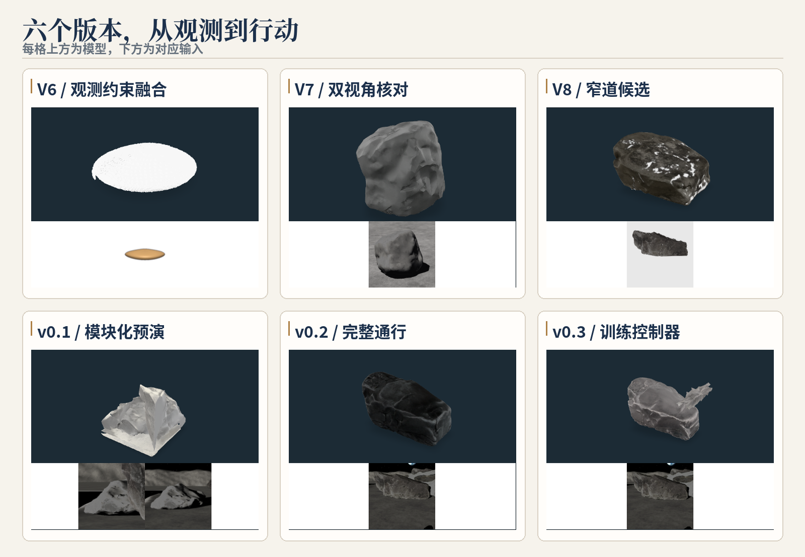

<div align="center">
  
  <p><sub>NEXT ZENITH · AHOLO HACKATHON</sub></p>
  <h1>先见一步 · BeforeStep</h1>
  <p><b>给机器人空间想象：从有限观测预测局部空间，先判断，再探索。</b></p>
  <p>
    <a href="https://codezzzsleep.github.io/next-zenith-beforestep/play.html"><b>开始月面探索</b></a> ·
    <a href="https://b23.tv/4CAPaLu">B站主宣传片</a> ·
    <a href="https://codezzzsleep.github.io/next-zenith-beforestep/report.html">主报告 V5</a><br>
    <a href="https://codezzzsleep.github.io/next-zenith-beforestep/">作品首页</a> ·
    <a href="https://github.com/codezzzsleep/next-zenith-beforestep/releases/tag/judges-demo-20261118">下载原片</a> ·
    <a href="docs/code-tour.md">代码导览</a>
  </p>
  <a href="https://b23.tv/4CAPaLu">
    
  </a>
  <p><sub>原始照片 → 对应 Lux3D 模型 · R1 研究原片 / Go2W · 点击观看作者已发布的 B站主宣传片</sub></p>
</div>

BeforeStep 是 Next Zenith 的月面轮腿机器人仿真作品。它**用 Lux3D 的图生三维能力构建可检验的局部空间假设**：从照片想象未见的形状，结合已有观测核对，将候选放回通道，再用物理预演判断怎样走。生成模型的形状与占地实际参与路线和碰撞计算。

我们把这个先想后走的模块比喻成机器人的**前额叶**。岩石是已验证的局部实例；看见正面之后，机器人还需要判断：背面会占多大地方，这条路是否能过，下一步应该前进、补看还是停下。

> **一张普通照片，多个可能的背面。** 在可能的世界里先走一遍，再回到原场景检验判断。

项目保留 **400 多次真实 Lux3D 生成任务**的输入、原 GLB、任务身份、被拒候选与运行结果。[完整故事与来源](docs/submission-story-20261117.md) · [当前交付状态](docs/current-status.md)。

## 从照片到下一步行动

<picture>
  <source media="(max-width: 600px)" srcset="docs/readme/showcase/flow-mobile.png">
  
</picture>

**Lux3D 接收普通 RGB 图片**，返回物体级的三维形状假设。项目已有的 RGB-D、位姿与地形提供尺度和本地配准依据；BeforeStep 核对可见部分、计算占地与路线，MuJoCo 计算运动和接触。候选核对、完整预演与独立执行各有自己的记录。

原 R1 窄道中，六份石头 A 模型与两份石头 B 模型组成 **12 个世界**。同一条候选路线在所有组合里完整预演，再回到原场景执行。局部几何由 Lux3D 提供，行动后果由系统和物理引擎检验。[研究链路与源码](docs/code-tour.md) · [Lux3D 输入与事实核查](docs/submission-story-sources-20261117.md)。

## 这次，你来开机器人

**穿过高石，跨过矮坎，在青色信标里停稳。** [打开月面探索](https://codezzzsleep.github.io/next-zenith-beforestep/play.html)，按 Enter 开始，使用 WASD / 方向键驾驶、空格刹车；手机使用摇杆与对应按钮。

<a href="https://codezzzsleep.github.io/next-zenith-beforestep/play.html">
  
</a>

<p align="center"><sub>试玩原片中的轮腿操作 · M20 显示外观 · 点击进入浏览器任务</sub></p>

1. **先留下自己的判断。** 靠近高石观察点，车体停稳并切到第一视角，在自然遮挡下选择“能过”“绕开”或“拿不准”。
2. **选择怎样探索。** 你可以自己开、让 Lux3D 想一想、再看一眼或停车。按 Q 展开原照片、同图两份真实候选、配准占地和规划路线。
3. **在假设里试路，再回现场。** 辅助出发需要从当前停稳位置完成所选世界的物理预演；途中可以手动接管。按 E 补看，将实际测到的新表面带回本局地图。
4. **亲手完成轮腿跨越。** 高石后再观察矮坎，停稳、对正，用四腿的 12 个主要动作跨过门槛，然后回到轮行、驶入信标。

| 操作 | 桌面按键 | 作用 |
| --- | --- | --- |
| 开始、驾驶与刹车 | Enter；WASD / 方向键；空格 | 在同一个物理世界中驾驶与制动 |
| 空间想象 / 补看 | Q / E | 查看已有真实候选，或采集本局的新表面 |
| 切换视角 | V | 第一、第三与俯视共用同一实时快照 |
| 逐腿跨越 | 1–4；J / K / L | 选腿，再分别抬起、前移、落地 |
| 探索练习继续 | R | 回到本局实际停稳检查点 |

浏览器运行 **MuJoCo 3.17 实时物理与原轮腿电机控制**。手控在初判后独立开放；辅助许可绑定所选模型、路线、停稳起点与本局观测版本。有效补看或改变选择会使旧许可失效。支撑与平衡由控制器辅助，主要跨越动作由玩家触发。

启动默认一份 A 与固定 B，形成 **1 个世界**；加入另一份同图 A 后形成 **2 个世界**，这是当前评审原片与公开整局验收使用的选集。原 R1 的 **12 个世界**作为研究证据另行保留。M20 是试玩显示外观，原 Go2W 动力学与控制保持；游戏成绩和研究结果分别记录。

探索练习支持检查点继续，全程挑战可以争取勘察印记与本机纪录，也可以换一组已有真实模型再试。桌面与 390px 触屏模拟已完成整局验收；手机真机性能尚未测量。

[操作与实现](docs/mission.md) · [练习、挑战与成绩](docs/playability.md) · [当前试玩验收](docs/judges-demo.md) · [加载方式](docs/startup-loading.md)。

## 看模型，也看机器人怎样走

<picture>
  <source media="(max-width: 600px)" srcset="docs/readme/showcase/model-action-mobile.jpg">
  
</picture>

[**模型陈列室**](https://codezzzsleep.github.io/next-zenith-beforestep/gallery.html)可以旋转真实返回的 GLB，查看任务和核对信息；[**原运行影片**](https://codezzzsleep.github.io/next-zenith-beforestep/#demo)展示机器人预演之后的独立行动。上图两侧取自保留的 R1 研究影片，使用 Go2W 条件。

同一条 R1 窄道，三种选择留下三种真实结果：

| 策略 | 观察次数 | 原运行结果 |
| --- | --- | --- |
| 直接走 · 乐观 | 1 眼 | 80.87 秒碰撞 |
| 看清再走 · 保守 | 5 眼 | 142.20 秒停车 |
| 想一想再走 · Lux3D + 完整预演 | 1 眼 | **112.84 秒到达** |

时间是原运行的**仿真时钟**。模型核对通过、预演完成，仍可能猜错背面。R2/R3 的原碰撞与收紧规则后的停车公开保留；这些结论与新游戏成绩分别计数。

[冻结 R1 记录](docs/reviews/RESULT_BEFORESTEP_R1.md) · [R2](docs/reviews/RESULT_BEFORESTEP_R2.md) · [R3](docs/reviews/RESULT_BEFORESTEP_R3.md) · [同路高石与低门槛](https://codezzzsleep.github.io/next-zenith-beforestep/crossing.html)。

<details>
<summary><b>展开原证据：可见面核对、完整十二世界与三策略终态</b></summary>

### 01 / 核对看见的一面


同字节原图的任务 5958654 通过核对，5958642 被拒。冻结轮廓门槛为 0.7068，原测量与拒绝原因保持。

### 02 / 在可能的世界里完整试走


六份 A × 两份 B；全图保留四乘三十二格，取自原预演影片的完整帧。

### 03 / 回到原场景检验判断



三种策略各自保留独立结果。视频时间码与终态仿真时间分别标识；[来源、任务与 SHA-256](site/media/home-evidence-20261118/sources.json)可逐项核对。

</details>

## 六个版本，留下每一步的证据

从 V6、V7、V8 到 v0.1、v0.2、v0.3，关键输入、模型、源码、配置与结果都保留在本仓库。图中每格上方是模型，下方是对应输入；手机使用两列排版，可以逐格查看。

<a href="https://codezzzsleep.github.io/next-zenith-beforestep/award-assets.html">
  <picture>
    <source media="(max-width: 600px)" srcset="docs/readme/showcase/versions-mobile.png">
    
  </picture>
</a>

| 版本 | 这一阶段增加什么 | 保留的结果与边界 |
| --- | --- | --- |
| V6 | 用观测约束融合几何 | 可见区域得到修复，未知背面仍未证明 |
| V7 | 双视角与冻结候选核对 | 不同视角并不一定改善生成形状 |
| V8 | 候选进入极地窄道决策 | 第二块石头候选全拒，原任务停车 |
| v0.1 | 模块化检查、完整预演与规范终态 | 原两图重试仍被拒；工程改进有独立记录 |
| v0.2 | 在有效关口完成整条链路 | 真实 Lux3D 分支到达；直接走对照也到达 |
| v0.3 | 训练模型控制与生成几何改路 | 训练控制器完成独立执行；失败和消融保留 |

**报告 V5 与这些技术版本分别编号。** v0.3.0 的历史发布、原附件与源提交继续保留；原 R1 研究采用冻结规则控制，试玩使用原动力学上的独立交互层。

[交互资产对比](https://codezzzsleep.github.io/next-zenith-beforestep/award-assets.html) · [技术里程碑](docs/milestones.md) · [核心资产与版本清单](evidence/award/asset-iterations/manifest.json) · [资产总索引](assets/manifest.json)。

## 报告、影片与剪辑素材

| 材料 | 当前入口 |
| --- | --- |
| **主报告 V5 · 11 页** | [逐页阅读](https://codezzzsleep.github.io/next-zenith-beforestep/report.html) · [原 PDF](reports/v5/report.pdf) · [报告版本与原文件](reports/README.md) |
| **B站主宣传片** | [作者已发布的视频](https://b23.tv/4CAPaLu)（BV1aYsw6REh7） |
| **连续 1080p 原片与补拍** | [固定 Release 下载](https://github.com/codezzzsleep/next-zenith-beforestep/releases/tag/judges-demo-20261118) · [母片、五图、时间码与研究索引](evidence/judges-demo/README.md) |
| 导演剪辑素材指南 | [112 秒成片的原素材与镜头顺序](docs/demo-edit-guide.md) |
| 历史影片与报告 | [185 秒完整作品 Demo](evidence/production-v6/README.md) · [Lux3D 配乐版](evidence/lux3d-demo-v2/README.md) · [V3/V4 原报告](reports/README.md) |

母片是约 5 分钟的连续原速仿真录制，另有清楚的模型/地图补拍、停车分支与五张图。最终 112 秒配音、音乐与字幕成片由导演制作；[原片目录](evidence/judges-demo/README.md)记录实际交付与下载核验范围。

累计账本为 **491 创建 / 460 成功 GLB / 31 失败**；V5 原稿中的 **467 创建 / 438 成功 / 29 失败**属于较早的归档节点。两组身份与统计分别保留，公开介绍使用“400 多次”。[原统计](evidence/production-v6/facts.json) · [V5 原件与配套说明](reports/v5/README.md)。

## 本地运行

### 浏览器试玩

在线体验直接[打开月面探索](https://codezzzsleep.github.io/next-zenith-beforestep/play.html)。本地使用同一份已生成资产：

```bash
GIT_LFS_SKIP_SMUDGE=1 git clone --depth 1 https://github.com/codezzzsleep/next-zenith-beforestep.git
cd next-zenith-beforestep
git lfs install --local
git lfs pull --include="site/**" --exclude=""
python3 -m http.server 8000 --bind 127.0.0.1
```

打开 <http://127.0.0.1:8000/site/play.html>。浏览器试玩复用已有真实模型，不需要 API 密钥，也不创建新的生成任务。

### 冻结 R1 研究链路

需要 **Python 3.12、Git LFS 与可用的 MuJoCo OpenGL 环境**。在同一仓库继续拉取研究资产、安装依赖：

```bash
git lfs pull --include="assets/runtime-*.tar.gz,assets/candidates/595*/tex_mesh.glb,evidence/reviews/beforestep_r1/lux/original_b/**,evidence/web-assets/**" --exclude=""
./setup.sh
MUJOCO_GL=egl .venv/bin/python ops/quickstart.py --reuse-lux --serve
```

命令完成冻结 R1 的观测、自检、十二世界完整预演与独立执行，随后在 <http://127.0.0.1:8080> 提供本地作品页。实际耗时随设备变化；[逐步命令、源码与输出位置](docs/code-tour.md)可用于复查。

<details>
<summary><b>依赖与更多历史素材</b></summary>

Ubuntu/Debian 缺少 `venv` 时，安装与 Python 3.12 对应的 `python3.12-venv`。视频与部分大型模型使用 Git LFS，按需拉取历史影片：

```bash
git lfs pull --include="evidence/lux3d-demo-v2/**,evidence/production-v6/film/**" --exclude=""
```

当前 1080p 原片通过上表的固定 Release 下载。V5 原 PDF 随仓库保存；[报告索引](reports/README.md)解释各版文件的来源。

全新克隆的历史验收记录在 [C5-fresh.json](evidence/award/acceptance/C5-fresh.json)，其设备与阶段不代表每台机器的当前耗时。控制、训练与 Arena 的研究作为独立附录保留。

</details>

## 源码、复现与来源

<p>
  
  
  
</p>

| 目录 / 资料 | 内容与入口 |
| --- | --- |
| [site/](site/) | 当前浏览器游戏、物理 Worker、观测、规划与交互；[代码导览](docs/code-tour.md) |
| [src/beforestep/](src/beforestep/) | 原研究的观测、生成、配准、自检、规划、预演与执行 |
| [assets/](assets/) · [evidence/](evidence/) | 原输入、生成网格、资产身份、失败、独立运行与版本证据 |
| [reports/](reports/) · [tools/](tools/) | V5 / V3 / V4 原报告、影片制作与可复现构建工具 |
| [完整参赛故事](docs/submission-story-20261117.md) | 项目为什么做、Lux3D 怎样参与，以及[事实来源](docs/submission-story-sources-20261117.md) |
| [项目目标](docs/project.md) · [交付决策](docs/decisions.md) | 当前能力、版本选择、证据保留与[参赛材料核对](docs/hackathon-submission.md) |
| [来源与致谢](docs/credits.md) | 模型、扫描岩石、物理引擎与字体；[相关研究](docs/related-work.md) · [参考文献](docs/references.bib) |
| [README 图文说明](docs/readme/README.md) | GIF、原片、拼版、手机排版、源 SHA 与重制方法 |

本仓库完整提供源码与参赛材料，版本复查依赖这里保留的文件与证据。私有凭据与运行记忆保存在公开仓库之外。

<p align="center"><sub>Next Zenith · 先见一步 BeforeStep</sub></p>
