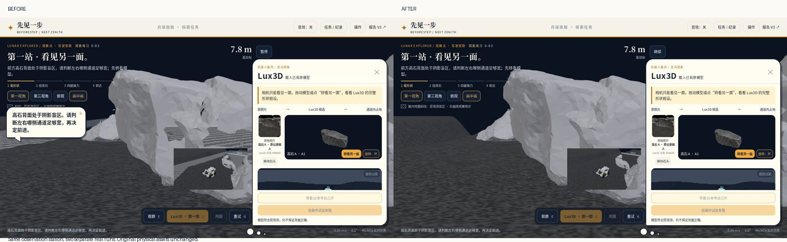

# 完整场景的 CDN 对照与渲染修正

本次对照没有发现 Cloudflare 在测试机上有明确的首开优势。52 次受控启动/重开测试中，两条线路的正常首开中位数都约 5.5 秒；固定 4 Mbps 后都约 67.5 秒。持久缓存对两条线路都有效，不能把缓存收益归因于 Cloudflare。

| 条件 | 每条线路样本数 | Cloudflare 中位数 | GitHub 中位数 |
| --- | ---: | ---: | ---: |
| 正常网络首次打开 | 7 | 5.47 秒 | 5.57 秒 |
| 正常网络持久缓存重开 | 7 | 6.56 秒 | 6.74 秒 |
| 4 Mbps / 120 ms 首次打开 | 3 | 67.54 秒 | 67.52 秒 |
| 4 Mbps / 120 ms 持久缓存重开 | 3 | 7.53 秒 | 7.26 秒 |

另做每端 3 次首次打开及 3 次重开的仅 HTTP 缓存对照，总计 52 次。每对交替先测 Cloudflare 或 GitHub，首次使用全新浏览器上下文，重开使用同一上下文。保持正常 HTTP 缓存，不发送强制绕过 CDN 缓存的请求头。页面、控制、解析与原始资产完全相同，只改变启动清单的镜像启用标志；五份资源在进入原仿真前仍核对大小与 SHA-256。

测试机位于日本，Cloudflare 节点为 NRT，浏览器为 1280 × 720 的 Chromium，使用 SwiftShader。4 Mbps 是浏览器限速，不是国内真实网络。正常首次配对差值的中位数约 −0.014 秒，重采样区间跨过 0；这些结果不能据此选出对国内所有访客都最快的线路。完整数据见[验证摘要](../evidence/cdn-comparison-20261118/verification.json)与[52 次逐样本 CSV](../evidence/cdn-comparison-20261118/startup-samples.csv)。

## 全场景里，等待发生在哪里

正常网络的两端 WASM/物理世界准备中位数均约 3.89 秒。Cloudflare 当前只覆盖 29,043,171 字节的五个启动 gzip 资源，原始 GLB、照片、视频与报告依然使用 GitHub 的原地址。

两条线路各完成一局实际游戏：选择全部 8 个准入候选，完整预演 12 个模型世界，沿认证路线绕行、接管驾驶，预演可见门槛，并由玩家触发 12 次轮腿动作后抵达。12 世界首遍耗时约 131.64 秒与 130.75 秒，期间没有外部 HTTP 请求；这是本地模型构建和物理计算，切换 CDN 不会缩短这部分。Cloudflare 另完成一遍相同 12 世界预演，仍约 131 秒。

此外实际打开 11 个原始候选、306 项模型陈列室、8 页报告及原 PDF、12 个原实验分析场景与 27 个叠合模型；首页旧归档视频首帧和中段跳转也通过。记录回放与这次实时预演分别标明，旧 185 秒视频不冒充新的 112 秒评审成片。以上素材均没有请求本次 Cloudflare 启动 ZIP。

## 更小的并行分段是否更快

现有 ZIP 使用 stored 格式，网页已经并行读取内部五个 gzip 对应的分段，并没有先下载整包再解压。

使用相同上传文件和原 SHA，交替做 5 对纯下载与校验测试：原五段中位数 0.382 秒，将每段限制为 2 MiB、增加到 17 段后为 0.596 秒。更多分段在该测试机上更慢，因此本轮保留现上传包，没有要求重新上传。这个结果只针对同一 ZIP 的更多 Range；未上传的独立小文件不能声称已经实测。

另用全新查询缓存键检查冷 CDN：第一个分段为 MISS，其余分段已经 HIT；再次请求均 HIT，确认目前的规则可以正常预热缓存。没有发现必须先手动下载整包才能缓存的问题。

## 场景来源和镂空、棋盘的原因

场景是项目用 MuJoCo 构造的月面主题导航测试环境，原 XML 的重力为 `0 0 -1.62`。月溪和地形由[场景程序](../src/beforestep/scene.py)构造，两块高石使用 Poly Haven 的 [rock_07](https://polyhaven.com/a/rock_07) 与 [moon_rock_04](https://polyhaven.com/a/moon_rock_04) 扫描素材，许可证为 CC0。它没有导入完整真实月球地形测绘平台；Lux3D 只提供实际候选岩石形状，并没有生成整个月面。

网页由 Three.js 重绘同一物理状态。旧显示层按各顶点是否接近观测点设置 0/1，再插值并裁掉低于 0.95 的片元，导致只有一个顶点未被标记的三角面也几乎整块消失。叠在三维地面上的高对比盲区纹理又造成大面积棋盘感。原扫描素材本身也记载为非封闭网格，不能把它当成没有开放底面的完整实体模型。

修正后按真实射线点和法线确认完整局部三角面，只补完全被已观测面围住的少量内部缺口；大块未知背面仍隐藏。主驾驶地面撤掉棋盘叠层，盲区标记留在脑内地图。原始扫描/生成模型、XML、碰撞、控制、准入和 V3 报告均保持。



修后三种视角在同一暂停物理状态下核对通过，原两世界预演仍通过。另做串行旧/新渲染器 3 对启动检查，中位数为 5.18 秒和 5.27 秒，分布重叠，未出现之前并发验收时的明显变慢。前后图片来自两个独立真实运行；修后同状态三视角另行核对，不把前后图片称为同一帧。

## 在其他网络复测

安装 Python Playwright 及 Chromium 后可运行[只读启动对照脚本](../tools/beforestep_mission/benchmark_cdn_startup.py)：

```sh
python tools/beforestep_mission/benchmark_cdn_startup.py \
  --output /tmp/beforestep-cdn-comparison.json --pairs 7 --slow-pairs 3
```

该脚本测届时实际部署的页面；本次归档摘要已记录原源码与 Pages 提交。原始资产在每次仿真初始化前仍由加载器核对。
