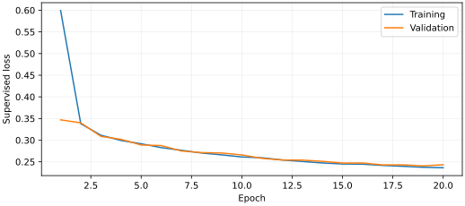
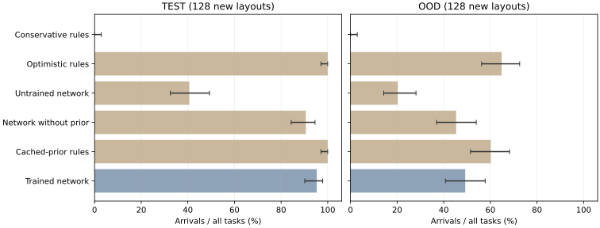

# 随机环境中的学习导航：首次完整结果

固定训练权重后，网络在新布局中到达 **122/128**，在更密/更大的分布外布局中到达
**63/128**。对应缓存先验规则为
128/128 与 77/128。
网络确实参与导航方向决策，已在独立新布局中实际执行；本次结果没有证明它超过规则。
物理与二维结果分开，首次初始化失败和修复后的新任务均保留。

[逐场交互回放](../site/navigation.html) · [机器可读完整结果](../evidence/learning/navigation_v1/result.json) ·
[测试前协议](learned-navigation-protocol.md) · [全部文件SHA](../evidence/learning/navigation_v1/custody.json)

## 模型实际学习了什么

4通道CNN读取已观测占据、已知区域、缓存先验占据、先验可用区域，预测可通行风险。
神经价值迭代用训练后的风险、代价、折扣和方向偏置输出八个移动方向分数。
模型共11132个参数，运行时不调用Dijkstra教师。训练真值和测试可达性判定仅在
仿真/监督/统计模块使用，不是控制器输入。观测更新、已见障碍门卫、八邻域拓扑
及重复状态记忆仍有规则；物理对照共用原已训练v4电机网络。

CPU实际训练20轮：1024训练场景/2048观测快照，64验证场景/128快照，耗时
215.567s。最低验证损失
0.240634，仅按验证损失选权重。
权重SHA：`de1dcec57a7debae25e611c5e46a45becb1634b1042ee22bed751917c70fa413`。



## 首次留出与对照

训练1100000–1101023、验证2100000–2100063、测试3100000–3100127、
分布外4100000–4100127、首次物理5100000–5100007、初始化修复后物理
5200000–5200007互不重叠。分布外只改变密度/尺度，不是未见岩石类别。
同一任务六种方法共用传感器、地图分辨率、观测预算和已见障碍门卫。
全部任务与可达任务均统计；不可达任务和失败没有剔除。

| 方法 | 新布局128 | 更密/更大128 | 首次物理8 | 初始化修复后新物理8 |
| --- | --- | --- | --- | --- |
| 训练导航网络 | 122/128；arrived 122 / loop 6 | 63/128；loop 65 / arrived 63 | 4/8；time_limit 1 / arrived 4 / tipped 3 | 5/8；arrived 5 / time_limit 2 / collision 1 |
| 缓存先验规则 | 128/128；arrived 128 | 77/128；stopped 51 / arrived 77 | 5/8；arrived 5 / tipped 3 | 7/8；arrived 7 / collision 1 |
| 网络去掉先验 | 116/128；loop 12 / arrived 116 | 58/128；loop 70 / arrived 58 | 未评估 | 未评估 |
| 未训练网络 | 52/128；loop 2 / time_limit 74 / arrived 52 | 26/128；time_limit 96 / arrived 26 / loop 6 | 未评估 | 未评估 |
| 乐观规则 | 128/128；arrived 128 | 83/128；stopped 45 / arrived 83 | 未评估 | 未评估 |
| 保守规则 | 0/128；stopped 128 | 0/128；stopped 128 | 未评估 | 未评估 |



| 任务组 | 方法 | 可达任务到达 | 全部任务平均路径m | 全景观察 | 被动观察 | 规划耗时s |
| --- | --- | --- | --- | --- | --- | --- |
| test | 训练导航网络 | 122/128 | 12.382 | 0.000 | 38.414 | 0.2188 |
| test | 缓存先验规则 | 128/128 | 11.805 | 0.000 | 35.727 | 0.5154 |
| ood | 训练导航网络 | 63/83 | 18.086 | 0.000 | 56.922 | 0.3274 |
| ood | 缓存先验规则 | 77/83 | 10.413 | 0.398 | 31.047 | 0.3928 |
| physical | 训练导航网络 | 4/8 | 7.147 | 0.000 | 10.000 | 0.2055 |
| physical | 缓存先验规则 | 5/8 | 7.485 | 0.000 | 9.375 | 0.4780 |
| physical_start_v2 | 训练导航网络 | 5/8 | 10.496 | 0.000 | 14.250 | 0.2824 |
| physical_start_v2 | 缓存先验规则 | 7/8 | 12.170 | 0.000 | 14.125 | 0.7396 |

路径均值包含未完成轨迹，因此不能直接当成功路线效率。规划耗时来自CPU实际调用，
不包含感知、云生成排队或整体仿真耗时。模型的较低规划耗时不等于端到端更快。
每场路径、观察、碰撞、终态与决策来源见完整JSON；物理接触与动作轨迹也保留。

训练网络与未训练网络的到达差异支持参数学习具有实际作用；去掉缓存先验的同网络
结果是独立消融。乐观规则在这个0.30m视线模拟中也可完成大量任务，表明此分布
不能证明Lux3D对任意导航的必要性，也不能代替冻结窄道RGB-D/Lux3D的原实验。

## 物理初始化问题与独立修复

首次8物理任务网络4到达/1超时/3翻倒，规则5到达/3翻倒，全部保留。
三场两方法均在初始化后立即数值不稳定。v1环境先在默认(0,0)构造并稳定化，
随后才移动到随机起点；默认位置与边界墙重叠。
[初始化诊断](../evidence/learning/navigation_v1/physics-start-diagnostic.json)确认
同一场重置后的倾角104.0717°，构造前设置原起点后为0.09444°。
诊断没有计作测试成绩；[首次警告](../evidence/learning/navigation_v1/history/MUJOCO-initialization-first.txt)保留。

独立 `navigation_physics_start_v2` 仅在构造前声明原起点，并把heightfield输出放入
本次目录；原v1代码与结果保持。验证2100063两方法均到达，109单测通过后
先提交预注册621c975，再运行新8种子。两批物理结果分列。
新实验的物理岩石是扫描俯视凸包的挤出体，传感器仍为二维视线/阴影；
它验证轮腿动作、到达与接触，不是生产RGB-D和新照片Lux3D实时闭环的验收。

## 真实大语言模型接入

参考[Agentic Observer](https://github.com/codezzzsleep/gosim26-agentic-observer)的数值证据加模型判断，
本项目独立实现结构化动作候选。数值规划计算距离、可见性、缓存先验阻塞和访问次数，
模型选择候选、观察或停车；回复校验候选身份，模型间隔与错误回退明确单列。
参考项目的数值曝光规划与本项目导航任务不同，没有复用其比赛得分作本项目证据。

实调用模型 `deepseek-v4-1-flash-261017`。首次8场25请求全HTTP403/1010，8/8到达均由规则回退，
不是LLM成功。只读连接诊断定位为默认Python User-Agent被服务拒绝。
兼容请求头后，在独立6100008–6100009两场新增6请求：
3有效回复、3解析失败。
实际移动来源为LLM 3步、咨询间隔图规划
65步、错误回退
3步。两方法均2/2到达，路径相同；
平均规划耗时规则0.784s，
混合LLM 14.580s。
该小样本验证了真实接入与动作记录，没有显示成功率改善。

累计31/32请求，旧失败身份计入总预算。请求发送前落盘；
不能换目录重置计数或重发已知身份。所有请求上下文、有效回复、用量和错误保留，
私有配置与凭证不进入仓库。真实Lux新增任务为0；缓存形状迁移不写成新云生成。

## 逐场网络失败

- test / 3100036: loop，目标误差 5.248m；[完整结果](../evidence/learning/navigation_v1/heldout/episodes/3100036-learned.json)。
- test / 3100060: loop，目标误差 7.225m；[完整结果](../evidence/learning/navigation_v1/heldout/episodes/3100060-learned.json)。
- test / 3100066: loop，目标误差 8.823m；[完整结果](../evidence/learning/navigation_v1/heldout/episodes/3100066-learned.json)。
- test / 3100110: loop，目标误差 3.132m；[完整结果](../evidence/learning/navigation_v1/heldout/episodes/3100110-learned.json)。
- test / 3100111: loop，目标误差 6.329m；[完整结果](../evidence/learning/navigation_v1/heldout/episodes/3100111-learned.json)。
- test / 3100115: loop，目标误差 6.185m；[完整结果](../evidence/learning/navigation_v1/heldout/episodes/3100115-learned.json)。
- ood / 4100000: loop，目标误差 6.742m；[完整结果](../evidence/learning/navigation_v1/heldout/episodes/4100000-learned.json)。
- ood / 4100001: loop，目标误差 5.029m；[完整结果](../evidence/learning/navigation_v1/heldout/episodes/4100001-learned.json)。
- ood / 4100002: loop，目标误差 4.657m；[完整结果](../evidence/learning/navigation_v1/heldout/episodes/4100002-learned.json)。
- ood / 4100003: loop，目标误差 5.604m；[完整结果](../evidence/learning/navigation_v1/heldout/episodes/4100003-learned.json)。
- ood / 4100004: loop，目标误差 7.589m；[完整结果](../evidence/learning/navigation_v1/heldout/episodes/4100004-learned.json)。
- ood / 4100006: loop，目标误差 3.015m；[完整结果](../evidence/learning/navigation_v1/heldout/episodes/4100006-learned.json)。
- ood / 4100007: loop，目标误差 9.396m；[完整结果](../evidence/learning/navigation_v1/heldout/episodes/4100007-learned.json)。
- ood / 4100008: loop，目标误差 4.025m；[完整结果](../evidence/learning/navigation_v1/heldout/episodes/4100008-learned.json)。
- ood / 4100009: loop，目标误差 9.534m；[完整结果](../evidence/learning/navigation_v1/heldout/episodes/4100009-learned.json)。
- ood / 4100010: loop，目标误差 8.238m；[完整结果](../evidence/learning/navigation_v1/heldout/episodes/4100010-learned.json)。
- ood / 4100012: loop，目标误差 4.327m；[完整结果](../evidence/learning/navigation_v1/heldout/episodes/4100012-learned.json)。
- ood / 4100017: loop，目标误差 7.422m；[完整结果](../evidence/learning/navigation_v1/heldout/episodes/4100017-learned.json)。
- ood / 4100020: loop，目标误差 9.203m；[完整结果](../evidence/learning/navigation_v1/heldout/episodes/4100020-learned.json)。
- ood / 4100021: loop，目标误差 8.078m；[完整结果](../evidence/learning/navigation_v1/heldout/episodes/4100021-learned.json)。
- ood / 4100022: loop，目标误差 6.420m；[完整结果](../evidence/learning/navigation_v1/heldout/episodes/4100022-learned.json)。
- ood / 4100023: loop，目标误差 9.391m；[完整结果](../evidence/learning/navigation_v1/heldout/episodes/4100023-learned.json)。
- ood / 4100024: loop，目标误差 4.243m；[完整结果](../evidence/learning/navigation_v1/heldout/episodes/4100024-learned.json)。
- ood / 4100029: loop，目标误差 9.827m；[完整结果](../evidence/learning/navigation_v1/heldout/episodes/4100029-learned.json)。
- ood / 4100031: loop，目标误差 6.958m；[完整结果](../evidence/learning/navigation_v1/heldout/episodes/4100031-learned.json)。
- ood / 4100033: loop，目标误差 7.943m；[完整结果](../evidence/learning/navigation_v1/heldout/episodes/4100033-learned.json)。
- ood / 4100034: loop，目标误差 7.554m；[完整结果](../evidence/learning/navigation_v1/heldout/episodes/4100034-learned.json)。
- ood / 4100036: loop，目标误差 5.474m；[完整结果](../evidence/learning/navigation_v1/heldout/episodes/4100036-learned.json)。
- ood / 4100039: loop，目标误差 7.023m；[完整结果](../evidence/learning/navigation_v1/heldout/episodes/4100039-learned.json)。
- ood / 4100041: loop，目标误差 4.327m；[完整结果](../evidence/learning/navigation_v1/heldout/episodes/4100041-learned.json)。
- ood / 4100042: loop，目标误差 7.299m；[完整结果](../evidence/learning/navigation_v1/heldout/episodes/4100042-learned.json)。
- ood / 4100043: loop，目标误差 7.518m；[完整结果](../evidence/learning/navigation_v1/heldout/episodes/4100043-learned.json)。
- ood / 4100044: loop，目标误差 9.080m；[完整结果](../evidence/learning/navigation_v1/heldout/episodes/4100044-learned.json)。
- ood / 4100045: loop，目标误差 6.641m；[完整结果](../evidence/learning/navigation_v1/heldout/episodes/4100045-learned.json)。
- ood / 4100048: loop，目标误差 4.460m；[完整结果](../evidence/learning/navigation_v1/heldout/episodes/4100048-learned.json)。
- ood / 4100049: loop，目标误差 7.649m；[完整结果](../evidence/learning/navigation_v1/heldout/episodes/4100049-learned.json)。
- ood / 4100051: loop，目标误差 9.005m；[完整结果](../evidence/learning/navigation_v1/heldout/episodes/4100051-learned.json)。
- ood / 4100052: loop，目标误差 5.515m；[完整结果](../evidence/learning/navigation_v1/heldout/episodes/4100052-learned.json)。
- ood / 4100053: loop，目标误差 8.405m；[完整结果](../evidence/learning/navigation_v1/heldout/episodes/4100053-learned.json)。
- ood / 4100056: loop，目标误差 6.307m；[完整结果](../evidence/learning/navigation_v1/heldout/episodes/4100056-learned.json)。
- ood / 4100058: loop，目标误差 7.379m；[完整结果](../evidence/learning/navigation_v1/heldout/episodes/4100058-learned.json)。
- ood / 4100059: loop，目标误差 6.413m；[完整结果](../evidence/learning/navigation_v1/heldout/episodes/4100059-learned.json)。
- ood / 4100061: loop，目标误差 8.453m；[完整结果](../evidence/learning/navigation_v1/heldout/episodes/4100061-learned.json)。
- ood / 4100063: loop，目标误差 8.319m；[完整结果](../evidence/learning/navigation_v1/heldout/episodes/4100063-learned.json)。
- ood / 4100064: loop，目标误差 7.500m；[完整结果](../evidence/learning/navigation_v1/heldout/episodes/4100064-learned.json)。
- ood / 4100066: loop，目标误差 6.907m；[完整结果](../evidence/learning/navigation_v1/heldout/episodes/4100066-learned.json)。
- ood / 4100067: loop，目标误差 6.329m；[完整结果](../evidence/learning/navigation_v1/heldout/episodes/4100067-learned.json)。
- ood / 4100069: loop，目标误差 3.354m；[完整结果](../evidence/learning/navigation_v1/heldout/episodes/4100069-learned.json)。
- ood / 4100070: loop，目标误差 2.766m；[完整结果](../evidence/learning/navigation_v1/heldout/episodes/4100070-learned.json)。
- ood / 4100073: loop，目标误差 6.357m；[完整结果](../evidence/learning/navigation_v1/heldout/episodes/4100073-learned.json)。
- ood / 4100076: loop，目标误差 4.696m；[完整结果](../evidence/learning/navigation_v1/heldout/episodes/4100076-learned.json)。
- ood / 4100078: loop，目标误差 5.692m；[完整结果](../evidence/learning/navigation_v1/heldout/episodes/4100078-learned.json)。
- ood / 4100079: loop，目标误差 8.357m；[完整结果](../evidence/learning/navigation_v1/heldout/episodes/4100079-learned.json)。
- ood / 4100083: loop，目标误差 8.533m；[完整结果](../evidence/learning/navigation_v1/heldout/episodes/4100083-learned.json)。
- ood / 4100091: loop，目标误差 3.015m；[完整结果](../evidence/learning/navigation_v1/heldout/episodes/4100091-learned.json)。
- ood / 4100092: loop，目标误差 5.977m；[完整结果](../evidence/learning/navigation_v1/heldout/episodes/4100092-learned.json)。
- ood / 4100094: loop，目标误差 8.298m；[完整结果](../evidence/learning/navigation_v1/heldout/episodes/4100094-learned.json)。
- ood / 4100097: loop，目标误差 5.341m；[完整结果](../evidence/learning/navigation_v1/heldout/episodes/4100097-learned.json)。
- ood / 4100099: loop，目标误差 5.825m；[完整结果](../evidence/learning/navigation_v1/heldout/episodes/4100099-learned.json)。
- ood / 4100101: loop，目标误差 8.828m；[完整结果](../evidence/learning/navigation_v1/heldout/episodes/4100101-learned.json)。
- ood / 4100102: loop，目标误差 2.100m；[完整结果](../evidence/learning/navigation_v1/heldout/episodes/4100102-learned.json)。
- ood / 4100103: loop，目标误差 4.025m；[完整结果](../evidence/learning/navigation_v1/heldout/episodes/4100103-learned.json)。
- ood / 4100104: loop，目标误差 3.511m；[完整结果](../evidence/learning/navigation_v1/heldout/episodes/4100104-learned.json)。
- ood / 4100105: loop，目标误差 8.078m；[完整结果](../evidence/learning/navigation_v1/heldout/episodes/4100105-learned.json)。
- ood / 4100107: loop，目标误差 5.507m；[完整结果](../evidence/learning/navigation_v1/heldout/episodes/4100107-learned.json)。
- ood / 4100110: loop，目标误差 6.661m；[完整结果](../evidence/learning/navigation_v1/heldout/episodes/4100110-learned.json)。
- ood / 4100111: loop，目标误差 8.368m；[完整结果](../evidence/learning/navigation_v1/heldout/episodes/4100111-learned.json)。
- ood / 4100113: loop，目标误差 4.429m；[完整结果](../evidence/learning/navigation_v1/heldout/episodes/4100113-learned.json)。
- ood / 4100117: loop，目标误差 3.015m；[完整结果](../evidence/learning/navigation_v1/heldout/episodes/4100117-learned.json)。
- ood / 4100119: loop，目标误差 7.500m；[完整结果](../evidence/learning/navigation_v1/heldout/episodes/4100119-learned.json)。
- ood / 4100124: loop，目标误差 6.742m；[完整结果](../evidence/learning/navigation_v1/heldout/episodes/4100124-learned.json)。
- physical / 5100000: time_limit，目标误差 1.795m；[完整结果](../evidence/learning/navigation_v1/physics/5100000-learned/result.json)。
- physical / 5100003: tipped，目标误差 9.789m；[完整结果](../evidence/learning/navigation_v1/physics/5100003-learned/result.json)。
- physical / 5100006: tipped，目标误差 9.731m；[完整结果](../evidence/learning/navigation_v1/physics/5100006-learned/result.json)。
- physical / 5100007: tipped，目标误差 10.525m；[完整结果](../evidence/learning/navigation_v1/physics/5100007-learned/result.json)。
- physical_start_v2 / 5200002: time_limit，目标误差 0.259m；[完整结果](../evidence/learning/navigation_v1/physics-start-v2/5200002-learned/result.json)。
- physical_start_v2 / 5200005: time_limit，目标误差 9.877m；[完整结果](../evidence/learning/navigation_v1/physics-start-v2/5200005-learned/result.json)。
- physical_start_v2 / 5200006: collision，目标误差 8.087m；[完整结果](../evidence/learning/navigation_v1/physics-start-v2/5200006-learned/result.json)。

其他方法全部逐场结果在heldout/episodes和physics目录，未经筛选；上述清单只方便查看网络失败。

## 运行与复现

```bash
python3 -m venv .venv-nav
.venv-nav/bin/pip install -r requirements.txt -r requirements-navigation.txt

# 任意新种子；输出场景和可编译的MuJoCo配置，不调用云生成。
PYTHONPATH=src MUJOCO_GL=egl .venv-nav/bin/python ops/learned_navigation.py generate \
  --seed 7200123 --distribution ood --mujoco --out outputs/navigation-new-world

# 发布的固定权重，重跑二维同种子对照；新目录保留独立运行身份。
PYTHONPATH=src .venv-nav/bin/python ops/learned_navigation.py evaluate \
  --training assets/models/navigation_v1 --out outputs/navigation-reproduction

# 初始化修复后的物理对照，原8场失败证据仍保留。
PYTHONPATH=src MUJOCO_GL=egl .venv-nav/bin/python ops/navigation_physics_start_v2.py \
  --training assets/models/navigation_v1 --out outputs/navigation-physics-reproduction

# 从头实际训练；已有输出仅用--resume续训，不能覆盖。
PYTHONPATH=src .venv-nav/bin/python ops/learned_navigation.py train \
  --out outputs/learning/navigation-new
```

下载[导航权重](../assets/models/navigation_v1/best.pt)、
[未训练对照](../assets/models/navigation_v1/untrained.pt)、
[原训练数据](../evidence/learning/navigation_v1/training/data.npz)、
[训练来源与SHA](../evidence/learning/navigation_v1/training/identity.json)。
训练快照由种子和形状库可复现，最新优化器/随机状态检查点也保留。
`evaluate`与物理入口支持`--resume`，要求权重、参数和源码身份相同，跳过完整回合。
完整冻结生产系统与新实验分别运行；新接口不修改54个原src文件。
