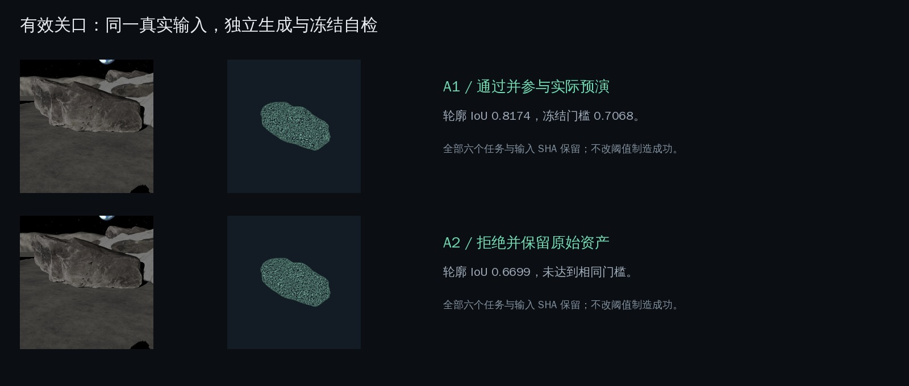
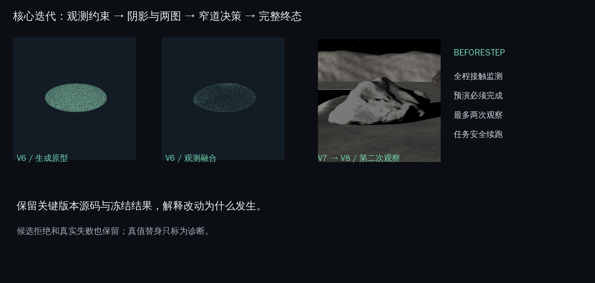

# 技术与资产迭代

本仓库保留关键技术版本的精选快照和真实资产，当前可运行实现位于 `src/beforestep`。历史快照解释技术演进，不作为第二套安装入口；各快照的来源提交、路径、摘要见 `assets/manifest.json`。

| 版本 | 问题与改动 | 资产/效果证据 | 局限 |
| --- | --- | --- | --- |
| V6 | 生成几何不完全符合可见表面，用观测约束进行融合修复 | `assets/geometry/reference_v6/{generated_parent,observation_fused}.stl`、`evidence/milestones/v6/fusion_manifest.json`、精选融合源码与配置 | 观测约束能修可见区域，未知背面仍需候选与执行验证 |
| V7 | 阴影中的深度不能视作已知，加入两图、冻结准入与复现约束 | `assets/inputs/reference_v7`、两份真实 GLB、`evidence/milestones/v7/{shadow_rows,shadow_summary,route_summary}.json`、源码与配置 | 不同视角与输入方式并非一定改善生成几何 |
| V8 | 将候选几何用于月球南极窄道的机器人选择，与保守/乐观策略比较 | 13 个原始候选、三组目标观测、`evidence/milestones/v8` 的原始决策和核心源码 | 第二块石头的单图与两图候选都没有通过原始冻结自检；原实现还缺规范终局 |
| BeforeStep | 按职责重构，修复全程碰撞、预演完成判定、两眼停止、缓存身份与付费续跑 | `src/beforestep`、`tests`、`evidence/delivery`、真实运行视频 | 新版本必须重新验证，不能照搬旧版本时长或替身结果 |

## V8 关键资产比较

| 观察与目标 | 真实生成情况 | 原始冻结自检 |
| --- | --- | --- |
| 第一眼 / T1 | A1、A2、B1、B2、C1、C2 六份成功 | B2、C2 采纳，2/6 |
| 第一眼 / T2 | 四份成功、两份失败；失败任务身份仍保留 | 四份均拒绝；A2 轮廓 IoU 0.6972，低于 0.7068 |
| 第二眼 / T2 | M1、M2、M3 真实两图调用成功 | 三份均拒绝，0/3 |

原始决策保存在 `evidence/milestones/v8/<look>_<target>/original_decision.json`。运行副本只迁移路径并清除运输凭据，输入图和 GLB 内容摘要保持可核验；配准后的新决策另存输出/交付证据。

## 独立新增实验

`experiments/polar_retry_001` 增加 M4–M15 共 12 份独立两图样本，沿用第一眼与第二眼的 A1 原始观察。受上传块大小限制，PNG 以 JPEG95 无缩放转码；请求中保存原始与转码摘要及原因。原始 GLB 按任务 ID 保存在 `assets/candidates`，冻结自检输出单独保存，不改写 M1–M3 的历史结论。

## 当前实现修复的效果

乐观策略的旧结果为 83.44s，包含碰撞后的额外物理推进。当前版本监测转向、驱动和 hold 中的接触，在 80.94s 真实碰撞时立即停止。两者属于不同实现版本，报告分别记录。

预演要同时满足所有路点完成和无碰撞；候选组合逐一预演。没有候选不能默认为预演成功，未到终点不能算到达。想象策略最多两次观察，候选持续被拒时保留明确的停下终态。

新增两图 M4–M15 最终 **12份生成成功、0份通过冻结自检**；详表见 `experiments/polar_retry_001/README.md`。规范 Lux3D 终局为两眼后停下/52.6s/无碰撞。此次迭代补齐终态与可追溯性，没有证明生成几何的收益改善。

## v0.2：把有效场景作为主体验

v0.1只有压力场景停下，未满足有效主展示目标。新增 `gate_passage_001` 保留岩壁、月溪、遮挡和实际绕行路线，独立物理可达性先验收；随后新真实Lux任务六个，四份GLB成功、两任务失败，A1/C1/C2通过相同冻结门槛、A2拒绝。

三份采纳候选各自预演完成/无碰撞，真实Lux分支一眼到达76.50s，目标误差约8.7毫米。保守同场景三眼118.76s到达，直接走同场景一眼76.50s到达。没有故意破坏对照或把仿真行程时间当端到端生成速度。

新资产与观测在 `assets/observations/gate_passage_001`、`assets/candidates/502*`；新任务/自检在 `experiments/gate_passage_001`；实际三组轨迹与预演在 `evidence/scenes/gate_passage_001`。v0.1原运行保存在 `evidence/milestones/beforestep_v0_1/delivery`，旧视频/图在 `site/media/history/stress_v8`，原Git标签v0.1.0保留。
