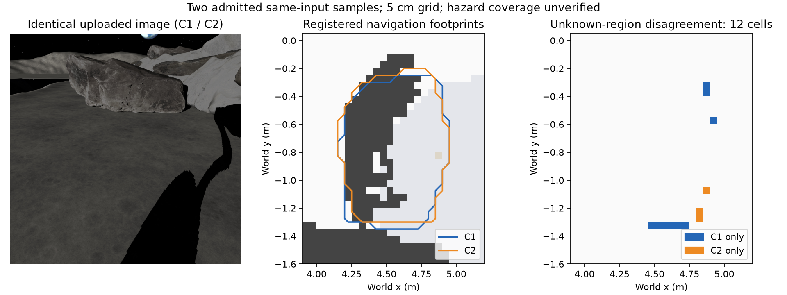

# 看不见的那一面：文献依据与项目贡献

BeforeStep 将未观测的岩石几何作为可检验的多候选假设，用实际观测筛选，再用同一规则控制器进行逐候选完整物理预演，支持通行或补充观察。相关研究已经证明，单视角补全可以有多种合理解释，机器人可以在多个形状上评价动作。我们的贡献定位为面向月面轮腿导航的系统方法与实际闭环，不主张首次提出多模态补全或不确定性规划。

## 最相关的五篇工作

| 论文 | 已有工作与支撑论点 | BeforeStep 的对应与区别 |
| --- | --- | --- |
| Saund、Berenson：[Diverse Plausible Shape Completions from Ambiguous Depth Images](https://proceedings.mlr.press/v155/saund21a.html)，CoRL 2020，PMLR 2021 | PSSNet 从单张 2.5D 深度图生成多种合理补全，指出候选变化可能过小，提出集合层面的合理多样性指标；验证遮挡物体及实体抓取。直接支撑“同图能否产生不同且合理的形状”这个问题。 | 使用 Lux3D 图片生成作为候选来源，并以 RGB-D 观测筛选；目前没有该论文的合理形状集合标注或覆盖评估。 |
| Zhou、Du、Wu：[3D Shape Generation and Completion through Point-Voxel Diffusion](https://arxiv.org/abs/2104.03670)，ICCV 2021 | PVD 用扩散模型实现条件多模态补全，展示单视角真实深度扫描的多个补全结果。支撑生成式模型作为几何假设来源。 | 当前是 Lux3D 原始网格的配准、自检与导航接入；没有重新训练 PVD，也没有证明 Lux3D 的样本是校准后验。 |
| Lundell、Verdoja、Kyrki：[Robust Grasp Planning Over Uncertain Shape Completions](https://arxiv.org/abs/1903.00645)，IROS 2019 | 同一输入通过测试时 MC-dropout 采样多个补全形状；抓取动作在各形状上评价，验证形状不确定性对行动规划的价值。最直接支撑“多个形状 → 动作评价”。 | 面向移动机器人，使用候选占据并集规划与逐候选完整动力学预演；没有采用它的平均解析抓取指标，也没有继承它的实体实验结论。 |
| Humt、Winkelbauer、Hillenbrand：[Shape Completion with Prediction of Uncertain Regions](https://arxiv.org/abs/2308.00377)，IROS 2023 | 模糊视角可能使整个缺失部件不可确定；预测不确定区域，避免这些区域可改善抓取。支撑显式保留未知区域与谨慎使用补全。 | 显式区分已知自由、可见岩石与未知区域，对候选做观测一致性检查。冻结检查通过只说明符合这些门槛，不证明隐藏部分正确。 |
| Menon、Zaenker、Dengler、Bennewitz：[NBV-SC: Next Best View Planning based on Shape Completion for Fruit Mapping and Reconstruction](https://arxiv.org/abs/2209.15376)，IROS 2023，预印本 2022 | 使用预测果实形状选择能看到未观测部分的视角，完成仿真与温室实体系统验证。支撑形状预测与补充观察之间的联系。 | R1 用目标可见高度和距离优先选择清楚且可达的第二眼，并以独立替身验证；本次真实 Lux 一眼到达，未真实触发第二眼。训练朝向头保留为附录，没有复现 NBV-SC 算法。 |

检索核验日期为 2026-11-10。依据为出版社页面、arXiv 摘要及元数据、选定正文段落和作者仓库；核验范围见 [primary_sources.json](../evidence/research/primary_sources.json)，引用见 [references.bib](references.bib)。这里没有声称完整阅读全部全文或复现论文实验。

## 比赛表达与科学主张

“生成模型补全看不见的部分，机器人先在这些可能形状里试走”能直接解释任务价值。把补全当假设而非真实重建，有上述研究支撑。任意生成错误本身没有价值；只有受到观测约束、保留不确定性并影响行动评价的假设才有用。

Lux3D 是本作品实际使用的核心生成器，原始资产确实参与规划和预演。PSSNet、PVD 等已有工作说明这项能力不具有科学上的 Lux3D 独占性。参赛队伍拥挤程度和评委偏好尚无数据，不能作为已验证的创新结论。

## 用保留资产回答最初的两个测试

本轮审计覆盖 `trained_live_gate_001` 的全部六个独立任务，按生成模式、版本、面数及实际上传图片的有序 SHA 分组，不把不同裁剪或编码当同图采样。原始结果为五份 GLB 成功、三份准入；A1/A2 同图均拒绝，B1/B2 同图只有一份成功且准入，C1/C2 同图均成功且准入。三个输入组来自同一岩石的处理变体，不能算三个独立物体。

| 测试 | 已有证据 | 判断边界 |
| --- | --- | --- |
| 同图多次生成是否有变化 | C1/C2 为同 JPEG、同 `img / G1-Turbo / 30000` 参数，任务 5125592/5125771。配准后全地图占据差 31 格，首次观测未知区差 12 格；5 cm 网格下未知占据 IoU 为 0.9124。 | 证明确有不同的可用候选占据。差异包括生成、配准和离散化影响；未知区包含阴影、遮挡、未见区域，不能直接称为背面专属变化。 |
| 候选是否合理 | C1/C2 均通过原冻结自检，轮廓 IoU 为 0.7861/0.8422，超过原 0.7068 门槛，尺度、可见接触和自由空间侵入等原检查也通过。 | 支持“符合当前观测约束”。仅两份有效同图样本，不能证明隐藏几何正确、真实危险形状被覆盖，或能够生成陡坎、凹槽。 |

审计 [audit.json](../evidence/research/same_input/audit.json) 保留全部任务组、成功与拒绝、输入和原网格 SHA、配准占据及源文件 SHA。离线脚本不调用生成服务、不改变准入：

```bash
.venv/bin/python evidence/research/same_input/build_evidence.py
```



<!-- SUITE-CONTRIBUTION-START -->
## 项目贡献：预注册场景组的实测范围

R2原冻结12个场景，完整完成12个；决定性场景中想象到达3、安全终止3、碰撞2。
全部分类与选择在本轮真实Lux结果之前完成，随后使用同一冻结流程、规则控制器与准入门槛；没有逐场景调参或训练新模型。逐场五种运行、任务身份、复盘与反事实见[场景组实测](suite.md)和[原始总表](../evidence/suite/summary.json)。

想象执行发生碰撞：suite_r2_v4_F1_020、suite_r2_v4_F3_004。这些失败限定了该流程的安全适用范围，不能以候选通过自检或预演代替实际安全。
没有满足预注册的多数决定性场景有效且无碰撞条件；贡献限于可复核的系统与逐类实测边界。
全部可执行拒绝候选反事实中碰撞17/102，另0份不能执行。自检确实拒绝过会导致碰撞的候选，具体比例和运行身份公开。
反事实完成试验包含规划停车，不能把未碰撞直接等同于成功通行；到达、停车、未完成和碰撞的终态在总表同时列出。
真实第二眼场景：suite_r2_v4_F0_001、suite_r2_v4_F0_005、suite_r2_v4_F1_001、suite_r2_v4_F2_003、suite_r2_v4_F2_007；真实6b追加场景：suite_r2_v4_F0_001、suite_r2_v4_F2_003。

这是有限扫描岩石、低太阳角与预注册摆放分布下的受控仿真实验。它没有比较多候选与单候选，也没有测量生成分布的覆盖率或证明任意月面的有效性；不继承上述论文的实体实验结论。
<!-- SUITE-CONTRIBUTION-END -->
## 项目贡献：冻结窄道里的行动实证

R1 在原 `stress_v8` A+B、同一传感器链、规则控制器和冻结门槛下完成主线比较：保守车无路线停车，黑影也能测深的对照到达，乐观车碰撞，真实 Lux3D 经自检和完整逐候选预演后到达。每次运行的身份、原始summary、观测、候选和轨迹见 [R1执行记录](reviews/RESULT_BEFORESTEP_R1.md)；赛后隐藏真值不进入生产规划。这支持本次场景中几何假设对行动判断的作用。

贡献在于把多候选生成、观测一致性检查、完整动力学预演、有限补看与独立执行接成可复核的轮腿导航系统。它没有证明多候选优于单候选，也没有证明生成分布覆盖所有真实危险形状。B 的全部可用被拒候选反事实均到达、无碰撞，本批自检偏保守，不能说自检挡住了会撞的想象。准入 B 的背面仍偏短，通行成功也不能当作背面重建准确。

旧 `gate_passage_001`、终点 `(5.7,-0.5)` 和训练控制实验移到迭代附录：去掉生成的同模型对照同样到达，没有证明 Lux3D 的必要性。旧 [实时任务验收](../evidence/scenes/trained_live_gate_001/validation.json) 和上述同图审计完整保留，各自结论不混入R1主对比。

岩石背面延伸挤窄通路属于本次绕行范围。“翻越岩石后遇到陡坎、凹槽卡轮”只是未来设想，本次比赛不做。项目未完成爬岩、陡坎或凹槽实验。

可用于介绍作品的表述是：**BeforeStep 用 Lux3D 提出盲区几何假设，以实际观测自检和同一规则控制器的完整物理预演支持行动，在证据不足时有限补看，并用独立执行核对结果。**
