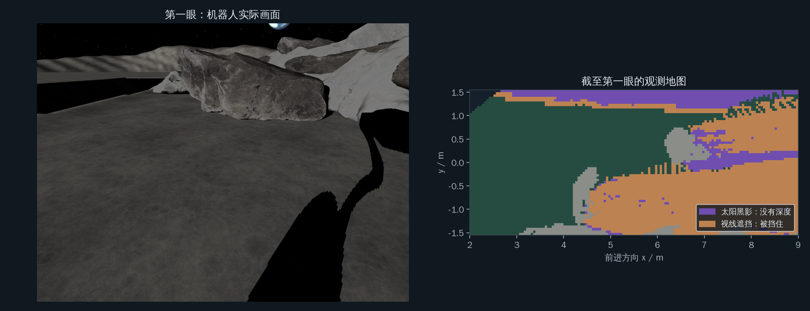
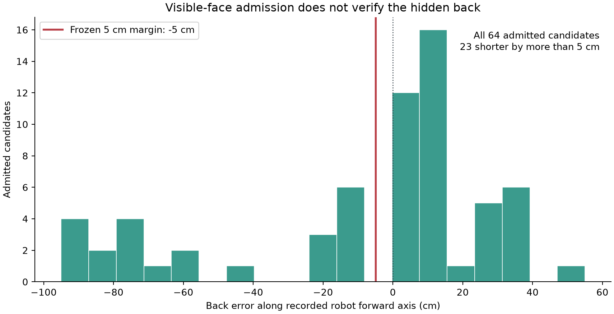
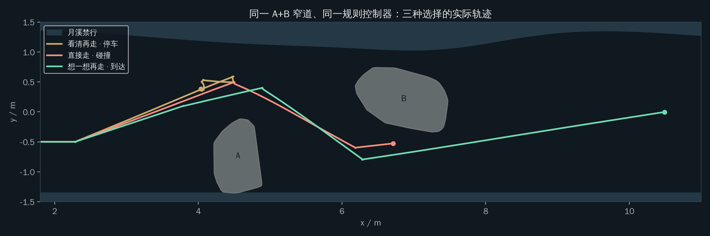
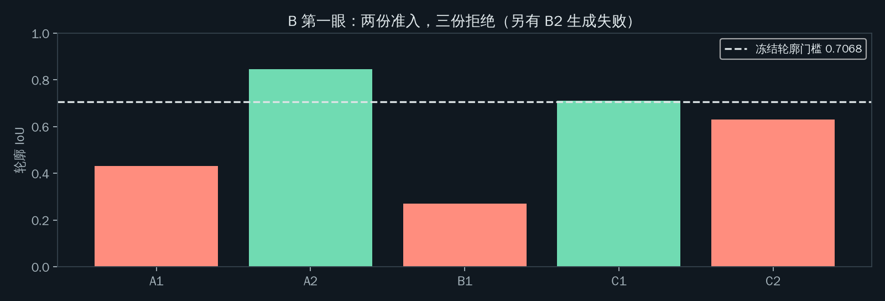
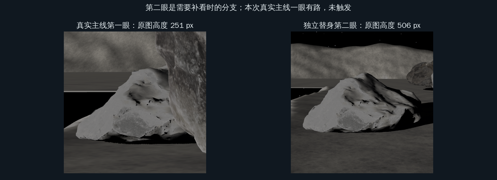
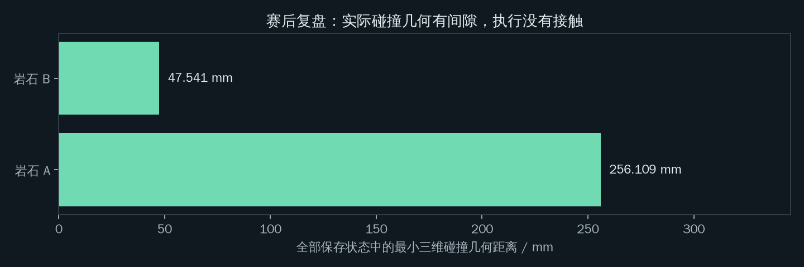
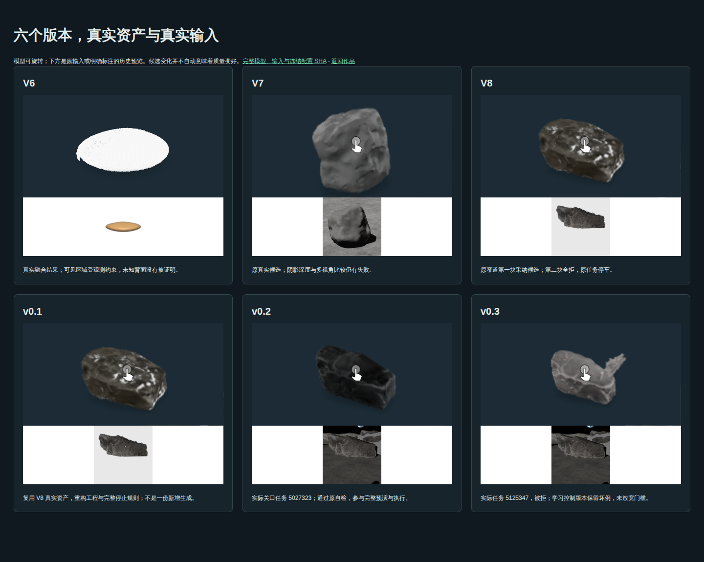

# 先见一步：一张照片，变成一整块石头

<!-- PHOTO-STORY-REPORT-START -->
机器人只拍到石头的一面。矮石头，相机看得到它的顶和背，轮腿抬腿跨过去；高石头，背面永远拍不到，Lux3D 把它想象出来，机器人检验、预演之后再绕。一条路上两种石头都有，少了腿或少了想象，都到不了。

锚点真实 Lux 分支1眼、112.84秒到达（仿真行程，不含云端生成墙钟），首眼12个真实任务返回11个模型、1个供应商失败。陈列室保留全部306份既有真实生成模型。

原8个已知决定性场景：3到达/3停车/2碰撞；5个指定留出：原想象1到达/2停车/2碰撞，最终v3赛后修订0到达/5停车/0碰撞。首页的13场/4到达/4碰撞是两个分层的算术相加，技术结论分别报告；全12个已知复测为3到达/9停车/0碰撞。

四次原方法碰撞均保留：suite_r2_v4_F1_020、suite_r2_v4_F3_004、suite_r2_v4_F0_003、suite_r2_v4_F3_006。F1_020碰到从未形成观测目标的C；另外三场低估B背面，正面自检与所有预演通过后仍实际接触。early oldv2 F1_003碰撞另列。原拒绝反事实17/102碰撞，R3已知0/17、留出13/112，合计231次干预、30次碰撞；干预次数不等于独立生成资产份数。

[作品首页](../site/index.html) · [全部想象](../site/gallery.html) · [真假叠合](../site/overlays.html) · [数字审计](../evidence/award/acceptance/home-numbers.json)。
<!-- PHOTO-STORY-REPORT-END -->

Next Zenith · Aholo Lux3D。报告保留R1原窄道锚点与R2预注册场景组；R1主实验源码 `2147b2f`，R2源码身份逐场保存在原运行记录。完整结果见[R1执行记录](reviews/RESULT_BEFORESTEP_R1.md)与[R2执行记录](reviews/RESULT_BEFORESTEP_R2.md)。

锚点场景中，想象车是三台车里唯一安全到达的；12 个预注册场景中，决定性 8 个：到达 3、安全停车 3、碰撞 2（原因已查明）。

## 两种影子，一个行动问题

太阳照不到的地方没有可靠深度；岩石挡住的地方也看不见。机器人沿月溪和大石堆之间的窄道前进，A 挡在前面，B 的一部分藏在盲区。第二次观察能改变视线遮挡，却不能照亮太阳黑影。系统让 Lux3D 提出符合可见观测的几何假设，检验路线后再行动。

<!-- R3-FAILURE-START -->
## 失败分析：想象只能检验看得见的一面

### F1_020：从没被看见的石头

C 完全藏在 A 后面，没有形成观测目标，任务数为 0；原计划路线侵入 C 的真实占地。原想象占据规则是乐观占据加候选占地，视线遮挡 HIDDEN 与未观测 UNSEEN 只要不落在候选中就可通行。**这是方法设计的缺陷，不是 Lux3D 没有生成 C 的问题。**

### F3_004：背面想错，正面仍通过自检

| 场景 | A | B | 地形 | 太阳高度 / 方位 |
| --- | --- | --- | --- | --- |
| stress_v8 | rock_07，0.55 m，(4.55, -0.73)，90° | moon_rock_04，0.42 m，(6.86, 0.22)，-26° | 窄道 | 10.0° / 35.0° |
| F3_004 | rock_07，0.53 m，(4.51, -0.70)，92° | moon_rock_04，0.43 m，(6.76, 0.16)，-23° | 开阔月面 + 1 个坑 | 10.4° / 38.8° |

B 的 A1、A2 轮廓 IoU 分别为 0.8429、0.8588，通过冻结自检；原计划路线却按真值压入 B 26.5 cm，实际发生碰撞。自检只约束可见的一面，不能证明不可见背面的假设正确。

锚点的三维最小间隙 **47.541 mm** 与二维包络间隙 **0 mm** 必须一起理解：同一块扁平石板、几乎相同的摆放换到开阔地形就撞了。**锚点的成功不稳健。** R1 原锚点仍是一眼到达的预注册结果，视频继续使用它，不替换成赛后修订结果。

### 全部准入候选的背面误差

原 R1 + R2 共 **64** 份通过自检的候选，其中 **23** 份的背面比关联真值短 **5 cm 以上**。误差为每次观测时沿机器人前进轴的候选占地最远端减真值最远端；图中的负 **5 cm** 线是冻结余量。联合观测对关联真值并集统计，所有准入候选逐份入列，真值仅用于赛后诊断，不能证明阴影中的几何已经还原。

[原始统计与每份候选身份](../evidence/reviews/beforestep_r3/back-error/stats.json) · [两次失败的原始数值](../evidence/reviews/beforestep_r3/failure-facts.json) · [给负责人渲染视频的数据索引](../evidence/video/index.json)

<!-- R3-FAILURE-END -->

<!-- AWARD-HOLDOUT-FAILURES-START -->
## 指定留出的两次原想象碰撞

- **suite_r2_v4_F0_003**：采纳几何的背面偏短，正面自检通过、18个候选世界完整预演全部通过，原路线仍在真实B旁发生接触（93.7s）；沿原观测前进轴的准入候选背面误差为 `[-0.3999138511360245, -0.3999425454676233, -0.7997990079404529]` m，计划二维包络侵入代理为 `0.17843487917553086` m。
- **suite_r2_v4_F3_006**：采纳几何的背面偏短，正面自检通过、12个候选世界完整预演全部通过，原路线仍在真实B旁发生接触（83.28s）；沿原观测前进轴的准入候选背面误差为 `[-0.8502062351769979, -0.8502062351769979]` m，计划二维包络侵入代理为 `0.12694207414826353` m。

背面误差和二维包络代理均为赛后真值诊断，不是生产输入，也不替代实际接触；不从它们推导三维穿透深度。只描述这两次原方法失败，最终v3修订停车的结果另列。[原身份、任务、候选及数值](../evidence/award/holdout-collisions.json)。

<!-- AWARD-HOLDOUT-FAILURES-END -->

## 窄道的约束

月溪与大石堆构成禁行边界，A遮住前方空间，B后半截凸进必须换道的通路。

## 三台车的实际结果

主场景保留 stress_v8 的 A+B、太阳、起点、第一眼和终点 `(10.5,0)`；所有主对比统一规则控制。保守车看五眼仍没有路线；只让相机在黑影里也有深度，三眼到达。乐观车碰撞，其出发前原计划车身压入真实 B 21.899 cm，满足原要求的至少 10 cm。真实 Lux3D 分支一眼到达，12 个候选组合预演全部完成且无碰撞，独立执行也无碰撞。

| 运行 | 结果 | 观察次数 | 仿真总时长 | 证据 |
| --- | --- | --- | --- | --- |
| 看清再走 | 无路线、停车 | 5 | 142.2 s | [原始身份](../evidence/reviews/beforestep_r1/section25_final_base/conservative/run_identity.json) |
| 黑影测深对照 | 到达 | 3 | 147.26 s | [原始身份](../evidence/reviews/beforestep_r1/section25_final_base/see_dark/run_identity.json) |
| 直接走 | 碰撞 | 1 | 80.87 s | [原始身份](../evidence/reviews/beforestep_r1/section25_final_base/optimistic/run_identity.json) |
| 想一想再走 | 到达 | 1 | 112.84 s | [原始身份](../evidence/reviews/beforestep_r1/lux/original_b/run_identity.json) |
| 真实形状检验 | 到达 | 1 | 115.88 s | [原始身份](../evidence/reviews/beforestep_r1/section25_final_base/truth/run_identity.json) |

这些结果支持在本次冻结场景中生成几何对行动判断的作用；不宣称对任意石头或场景都可靠。地图上的扫描轮廓只用于赛后复盘，生产规划器不读取隐藏真值。

## 真实生成、自检与被拒候选

首眼共提交 12 个独立真实任务，获得 11 个 GLB、1 个服务端失败。A 的六份全部准入；B 的五个可用模型中两份准入、三份拒绝。B2 任务 `5958893` 失败，无 GLB；不能将它计为自检拒绝。所有原始输入、实际上传字节、任务身份、模型、矩阵和占据保留在 [完整实验数据](../evidence/reviews/beforestep_r1/lux/original_b)。

| 候选 | 真实 task ID | 轮廓 IoU | 尺度比 | 冻结自检 |
| --- | --- | --- | --- | --- |
| B/A1 | 5958642 | 0.4325 | 1.0676 | 轮廓 IoU 低于 0.7068 |
| B/A2 | 5958654 | 0.8459 | 1.0 | 准入 |
| B/B1 | 5958703 | 0.2715 | 0.9324 | 轮廓 IoU 低于 0.7068 |
| B/C1 | 5958934 | 0.7108 | 0.9459 | 准入 |
| B/C2 | 5958937 | 0.63 | 0.9054 | 轮廓 IoU 低于 0.7068 |

轮廓门槛 0.7068、尺度比 0.889–1.09、壳层接触、已知自由空间侵入和未知比例等原门槛保持。准入表示符合当前可见观测，生成背面仍可能错误：两份准入 B 的后缘相对真实占据分别偏短 0.70 m、0.60 m。此次行动结果通过，不把它说成生成背面已准确。

## 第二眼的条件分支与配准修复

需要补看时，用目标可见高度、相机到最近观测格的距离和原图焦距估计像素高度；排除过近点，优先可达的 ≥512 px 点。两眼 native_ok 同时为真才调用两图三份，否则单用新视角六份；第二眼零准入仅追加同字节六份，合计十二仍零则停车，不看第三眼。

本次真实B首眼251 px、native_ok=false，仍有A2和C1两份准入。独立完整替身验证中，第二眼预计513.388 px，实际506 px，仍按单图分支。发现局部配准优化的稀疏点评分变好、最终可见面评分反而退化；修复只保留最终评分更好的矩阵。原自检与余量没有放宽，B替身修复后IoU为0.9673，完整两眼预演与执行到达。40 项单测通过。本次真实主线首眼已有准入和路线，第二眼、追加与 B 替换均未触发；不冒称做了新的多轮 Lux 生成。

## 在想象中预演，然后在独立世界执行

规划使用全部八份准入几何的占据；执行前，在 A 六份 × B 两份共十二种物理场景中完整运行同一规则控制器。十二格均完成、无碰撞，其全部轨迹与原配置在仓库。之后在独立扫描几何世界执行，实际到达。完整 `--reuse-lux` 重放再次完成十二格与独立执行，t、qpos、阶段和动作来源等全部数组逐字节相同，轨迹 SHA256 为 `6b1481752708b9a2c9039ad91e55f98493714924afdd52da1be0baaee4758d1e`。

## 赛后真值与间隙复盘

按每一个保存 qpos 重建原 MuJoCo 可碰撞几何，其最小有符号距离为 A 256.109 mm、B 47.541 mm，均为正，与执行无碰撞相容。XY 的 0.76×0.66 m 矩形包络对 B 间隙为零，中心距离减半车宽最小为 -62.778 mm；这是平面包络指标，同时公开（中心减半宽=-0.062778 m），不当作三维接触。原规划始终遵循冻结的 5 cm 占据扩张规则；不将 47.541 mm 向上写成真实 5 cm。

原运行墙钟 1223.6 s，含冷配准和完整物理预演，不含此前云端排队，不能称为端到端延迟；仿真总时长与执行时间分别记录在summary。

原始 [eval](../evidence/reviews/beforestep_r1/lux/original_b/eval.json)、[三维最近点和时刻](../evidence/reviews/beforestep_r1/lux/original_b/physical_clearance.json) 与 [完整重放核验](../evidence/reviews/beforestep_r1/replay_validation.json) 可独立检查。

## 全部反事实：本批自检偏保守

按预注册逐一只信 B 第一眼被拒的 A1、B1、C2，不挑选，不补看，不重新调用 Lux3D。三次均到达、无碰撞，碰撞数 0/3。因此此次不能说“自检挡住了会撞的想象”；结论是本批自检偏保守。

| 只信的被拒 B | 实际终态 | 仿真总时长 | 证据 |
| --- | --- | --- | --- |
| B/A1 | 到达、无碰撞 | 104.0 s | [原始身份](../evidence/reviews/beforestep_r1/counterfactuals/A1/run_identity.json) |
| B/B1 | 到达、无碰撞 | 104.0 s | [原始身份](../evidence/reviews/beforestep_r1/counterfactuals/B1/run_identity.json) |
| B/C2 | 到达、无碰撞 | 119.16 s | [原始身份](../evidence/reviews/beforestep_r1/counterfactuals/C2/run_identity.json) |

## 关卡：先选，再揭晓

每关先看真实第一眼，选策略，回放原物理轨迹，再看真值与全部候选、记分。[进入12关](../site/levels.html)。

<!-- SUITE-START -->
# 预注册月面场景组

场景组在任何本轮 Lux3D 结果之前冻结。选择只依据保守、see-dark、乐观和真实形状检验四次非 Lux 运行；各类别按种子从小到大取决定性与普通场景，stress_v8 直接使用已完成的 R1 锚点。冻结后不换场景、不放宽门槛、不迭代控制器。

原冻结 12 个场景，完成 12 个。未完成：无。

[冻结名单与预期](../config/suite/frozen.json) · [原始结果总表](../evidence/suite/summary.json)

## 候选池分布

| 类别 | 候选数 | 决定性 | 普通 | 无解 | 未归类 | 执行错误 |
| --- | ---: | ---: | ---: | ---: | ---: | ---: |
| F0 | 12 | 9 | 2 | 1 | 0 | 0 |
| F1 | 24 | 2 | 10 | 8 | 4 | 0 |
| F2 | 12 | 3 | 8 | 0 | 1 | 0 |
| F3 | 12 | 5 | 3 | 2 | 2 | 0 |

决定性：真实形状检验到达，乐观碰撞，保守停车或用满五眼。普通：真实形状与乐观均到达。无解：真实形状检验不到达。执行错误不会算成无解或被隐藏。此前错误池与参数调整理由保留在[决策记录](decisions.md)与[R2结果](reviews/RESULT_BEFORESTEP_R2.md)。

## 五次运行

| 场景 / 类别 / 分类 / 种子 | 保守 | see-dark | 乐观 | 真实形状检验 | 真实 Lux3D |
| --- | --- | --- | --- | --- | --- |
| stress_v8 / F0 / 决定性 / R1锚点 | 安全停车 · 5眼 · 142.2s · [身份](../evidence/reviews/beforestep_r1/section25_final_base/conservative/run_identity.json) | 到达 · 3眼 · 147.26s · [身份](../evidence/reviews/beforestep_r1/section25_final_base/see_dark/run_identity.json) | 碰撞 · 1眼 · 80.87s · [身份](../evidence/reviews/beforestep_r1/section25_final_base/optimistic/run_identity.json) | 到达 · 1眼 · 115.88s · [身份](../evidence/reviews/beforestep_r1/section25_final_base/truth/run_identity.json) | 到达 · 1眼 · 112.84s · [身份](../evidence/reviews/beforestep_r1/lux/original_b/run_identity.json) |
| suite_r2_v4_F0_001 / F0 / 决定性 / 1 | 安全停车 · 5眼 · 142.92s · [身份](../evidence/suite/scenes/suite_r2_v4_F0_001/runs/conservative/run_identity.json) | 到达 · 3眼 · 145.24s · [身份](../evidence/suite/scenes/suite_r2_v4_F0_001/runs/see_dark/run_identity.json) | 碰撞 · 1眼 · 80.83s · [身份](../evidence/suite/scenes/suite_r2_v4_F0_001/runs/optimistic/run_identity.json) | 到达 · 1眼 · 114.84s · [身份](../evidence/suite/scenes/suite_r2_v4_F0_001/runs/truth/run_identity.json) | 安全停车 · 2眼 · 54.58s · [身份](../evidence/suite/scenes/suite_r2_v4_F0_001/runs/imagination/run_identity.json) |
| suite_r2_v4_F0_005 / F0 / 普通 / 5 | 安全停车 · 5眼 · 143.98s · [身份](../evidence/suite/scenes/suite_r2_v4_F0_005/runs/conservative/run_identity.json) | 到达 · 3眼 · 151.76s · [身份](../evidence/suite/scenes/suite_r2_v4_F0_005/runs/see_dark/run_identity.json) | 到达 · 1眼 · 102.42s · [身份](../evidence/suite/scenes/suite_r2_v4_F0_005/runs/optimistic/run_identity.json) | 到达 · 1眼 · 114.6s · [身份](../evidence/suite/scenes/suite_r2_v4_F0_005/runs/truth/run_identity.json) | 安全停车 · 2眼 · 53.0s · [身份](../evidence/suite/scenes/suite_r2_v4_F0_005/runs/imagination/run_identity.json) |
| suite_r2_v4_F1_001 / F1 / 决定性 / 1 | 安全停车 · 5眼 · 111.74s · [身份](../evidence/suite/scenes/suite_r2_v4_F1_001/runs/conservative/run_identity.json) | 碰撞 · 4眼 · 91.03s · [身份](../evidence/suite/scenes/suite_r2_v4_F1_001/runs/see_dark/run_identity.json) | 碰撞 · 1眼 · 72.47s · [身份](../evidence/suite/scenes/suite_r2_v4_F1_001/runs/optimistic/run_identity.json) | 到达 · 2眼 · 124.38s · [身份](../evidence/suite/scenes/suite_r2_v4_F1_001/runs/truth/run_identity.json) | 安全停车 · 2眼 · 42.7s · [身份](../evidence/suite/scenes/suite_r2_v4_F1_001/runs/imagination/run_identity.json) |
| suite_r2_v4_F1_020 / F1 / 决定性 / 20 | 安全停车 · 5眼 · 129.12s · [身份](../evidence/suite/scenes/suite_r2_v4_F1_020/runs/conservative/run_identity.json) | 未完成 · 4眼 · 121.09s · [身份](../evidence/suite/scenes/suite_r2_v4_F1_020/runs/see_dark/run_identity.json) | 碰撞 · 1眼 · 79.24s · [身份](../evidence/suite/scenes/suite_r2_v4_F1_020/runs/optimistic/run_identity.json) | 到达 · 1眼 · 78.16s · [身份](../evidence/suite/scenes/suite_r2_v4_F1_020/runs/truth/run_identity.json) | 碰撞 · 1眼 · 61.46s · [身份](../evidence/suite/scenes/suite_r2_v4_F1_020/runs/imagination/run_identity.json) |
| suite_r2_v4_F1_003 / F1 / 普通 / 3 | 碰撞 · 4眼 · 134.49s · [身份](../evidence/suite/scenes/suite_r2_v4_F1_003/runs/conservative/run_identity.json) | 到达 · 5眼 · 129.45s · [身份](../evidence/suite/scenes/suite_r2_v4_F1_003/runs/see_dark/run_identity.json) | 到达 · 1眼 · 105.18s · [身份](../evidence/suite/scenes/suite_r2_v4_F1_003/runs/optimistic/run_identity.json) | 到达 · 1眼 · 99.64s · [身份](../evidence/suite/scenes/suite_r2_v4_F1_003/runs/truth/run_identity.json) | 到达 · 1眼 · 108.0s · [身份](../evidence/suite/scenes/suite_r2_v4_F1_003/runs/imagination/run_identity.json) |
| suite_r2_v4_F2_003 / F2 / 决定性 / 3 | 安全停车 · 5眼 · 83.06s · [身份](../evidence/suite/scenes/suite_r2_v4_F2_003/runs/conservative/run_identity.json) | 到达 · 4眼 · 165.2s · [身份](../evidence/suite/scenes/suite_r2_v4_F2_003/runs/see_dark/run_identity.json) | 碰撞 · 1眼 · 82.79s · [身份](../evidence/suite/scenes/suite_r2_v4_F2_003/runs/optimistic/run_identity.json) | 到达 · 1眼 · 124.92s · [身份](../evidence/suite/scenes/suite_r2_v4_F2_003/runs/truth/run_identity.json) | 安全停车 · 2眼 · 57.8s · [身份](../evidence/suite/scenes/suite_r2_v4_F2_003/runs/imagination/run_identity.json) |
| suite_r2_v4_F2_007 / F2 / 决定性 / 7 | 安全停车 · 5眼 · 83.33s · [身份](../evidence/suite/scenes/suite_r2_v4_F2_007/runs/conservative/run_identity.json) | 到达 · 4眼 · 157.28s · [身份](../evidence/suite/scenes/suite_r2_v4_F2_007/runs/see_dark/run_identity.json) | 碰撞 · 1眼 · 80.41s · [身份](../evidence/suite/scenes/suite_r2_v4_F2_007/runs/optimistic/run_identity.json) | 到达 · 1眼 · 112.56s · [身份](../evidence/suite/scenes/suite_r2_v4_F2_007/runs/truth/run_identity.json) | 到达 · 2眼 · 128.4s · [身份](../evidence/suite/scenes/suite_r2_v4_F2_007/runs/imagination/run_identity.json) |
| suite_r2_v4_F2_001 / F2 / 普通 / 1 | 安全停车 · 5眼 · 83.43s · [身份](../evidence/suite/scenes/suite_r2_v4_F2_001/runs/conservative/run_identity.json) | 到达 · 3眼 · 133.18s · [身份](../evidence/suite/scenes/suite_r2_v4_F2_001/runs/see_dark/run_identity.json) | 到达 · 1眼 · 102.5s · [身份](../evidence/suite/scenes/suite_r2_v4_F2_001/runs/optimistic/run_identity.json) | 到达 · 1眼 · 102.5s · [身份](../evidence/suite/scenes/suite_r2_v4_F2_001/runs/truth/run_identity.json) | 到达 · 1眼 · 102.7s · [身份](../evidence/suite/scenes/suite_r2_v4_F2_001/runs/imagination/run_identity.json) |
| suite_r2_v4_F3_002 / F3 / 决定性 / 2 | 安全停车 · 5眼 · 218.48s · [身份](../evidence/suite/scenes/suite_r2_v4_F3_002/runs/conservative/run_identity.json) | 到达 · 5眼 · 119.05s · [身份](../evidence/suite/scenes/suite_r2_v4_F3_002/runs/see_dark/run_identity.json) | 碰撞 · 1眼 · 80.4s · [身份](../evidence/suite/scenes/suite_r2_v4_F3_002/runs/optimistic/run_identity.json) | 到达 · 1眼 · 117.54s · [身份](../evidence/suite/scenes/suite_r2_v4_F3_002/runs/truth/run_identity.json) | 到达 · 1眼 · 107.6s · [身份](../evidence/suite/scenes/suite_r2_v4_F3_002/runs/imagination/run_identity.json) |
| suite_r2_v4_F3_004 / F3 / 决定性 / 4 | 安全停车 · 1眼 · 18.1s · [身份](../evidence/suite/scenes/suite_r2_v4_F3_004/runs/conservative/run_identity.json) | 未完成 · 4眼 · 129.63s · [身份](../evidence/suite/scenes/suite_r2_v4_F3_004/runs/see_dark/run_identity.json) | 碰撞 · 1眼 · 79.59s · [身份](../evidence/suite/scenes/suite_r2_v4_F3_004/runs/optimistic/run_identity.json) | 到达 · 1眼 · 106.44s · [身份](../evidence/suite/scenes/suite_r2_v4_F3_004/runs/truth/run_identity.json) | 碰撞 · 1眼 · 82.14s · [身份](../evidence/suite/scenes/suite_r2_v4_F3_004/runs/imagination/run_identity.json) |
| suite_r2_v4_F3_001 / F3 / 普通 / 1 | 未完成 · 2眼 · 111.83s · [身份](../evidence/suite/scenes/suite_r2_v4_F3_001/runs/conservative/run_identity.json) | 到达 · 3眼 · 125.97s · [身份](../evidence/suite/scenes/suite_r2_v4_F3_001/runs/see_dark/run_identity.json) | 到达 · 1眼 · 111.88s · [身份](../evidence/suite/scenes/suite_r2_v4_F3_001/runs/optimistic/run_identity.json) | 到达 · 1眼 · 107.64s · [身份](../evidence/suite/scenes/suite_r2_v4_F3_001/runs/truth/run_identity.json) | 到达 · 1眼 · 112.5s · [身份](../evidence/suite/scenes/suite_r2_v4_F3_001/runs/imagination/run_identity.json) |

B4在付费前发现并纠正预演中的旧右墙配置遗漏。上表全部新增场景的四基线随后统一重跑，与真实Lux使用相同源码；最初用于选取的四次结果仍保存在冻结名单中，没有据修正后的结果增删或替换场景。
[同源基线回归](../evidence/suite/pool/crater-target-baselines/manifest_results.json)。修正后分类发生变化的场景：无。

每项时间为原始 summary 的仿真总时长，包含该运行的接近与观察，不包含云端排队。自检计算与预演计算墙钟另在原运行中保留，不作为端到端速度优势。所有运行使用 rules，传感器、机器人与5cm规则保持冻结；真实Lux流程使用同一准入门槛、最多两眼，保守、see-dark与乐观对照保留最多五眼，真实形状检验也最多两眼。真实形状是独立检验，未提供给生产规划器。

## 候选与补看

| 场景 | 真实岩石 | 任务 / 成功 / 准入 | 原视角高度与方式 | 第二眼 | 6b |
| --- | --- | --- | --- | --- | --- |
| stress_v8 | A | 6 / 6 / 6 | look1/T1: 765px, native_ok=True, img | 否 | 否 |
| stress_v8 | B | 6 / 5 / 2 | look1/T2: 251px, native_ok=False, img | 否 | 否 |
| suite_r2_v4_F0_001 | A | 6 / 6 / 4 | look1/T1: 768px, native_ok=True, img | 是 | 否 |
| suite_r2_v4_F0_001 | B | 18 / 18 / 0 | look1/T2: 260px, native_ok=False, img; look2/T2: 527px, native_ok=True, img | 是 | 是 |
| suite_r2_v4_F0_005 | A | 9 / 9 / 0 | look1/T1: 805px, native_ok=True, img; look2/T1: 1249px, native_ok=True, imgs | 是 | 否 |
| suite_r2_v4_F0_005 | B | 12 / 12 / 1 | look1/T2: 248px, native_ok=False, img; look2/T2: 336px, native_ok=False, img | 是 | 否 |
| suite_r2_v4_F1_001 | A | 6 / 6 / 2 | look1/T1: 679px, native_ok=True, img | 是 | 否 |
| suite_r2_v4_F1_001 | B | 6 / 4 / 0 | look1/T2: 351px, native_ok=False, img | 是 | 否 |
| suite_r2_v4_F1_001 | C | 0 / 0 / 0 | 全程没有生成观测请求 | 是 | 否 |
| suite_r2_v4_F1_020 | A | 6 / 4 / 1 | look1/T1: 957px, native_ok=True, img | 否 | 否 |
| suite_r2_v4_F1_020 | B | 6 / 4 / 2 | look1/T2: 363px, native_ok=False, img | 否 | 否 |
| suite_r2_v4_F1_020 | C | 0 / 0 / 0 | 全程没有生成观测请求 | 否 | 否 |
| suite_r2_v4_F1_003 | A | 6 / 6 / 3 | look1/T1: 621px, native_ok=True, img | 否 | 否 |
| suite_r2_v4_F1_003 | B | 6 / 6 / 2 | look1/T2: 322px, native_ok=False, img，共享目标 B+C | 否 | 否 |
| suite_r2_v4_F1_003 | C | 6 / 6 / 2 | look1/T2: 322px, native_ok=False, img，共享目标 B+C | 否 | 否 |
| suite_r2_v4_F2_003 | A | 9 / 8 / 5 | look1/T1: 721px, native_ok=True, img; look2/T1: 1715px, native_ok=True, imgs | 是 | 否 |
| suite_r2_v4_F2_003 | B | 18 / 18 / 4 | look1/T2: 223px, native_ok=False, img; look2/T2: 773px, native_ok=True, img | 是 | 是 |
| suite_r2_v4_F2_007 | A | 6 / 6 / 5 | look1/T1: 705px, native_ok=True, img | 是 | 否 |
| suite_r2_v4_F2_007 | B | 12 / 10 / 2 | look1/T2: 269px, native_ok=False, img; look2/T2: 509px, native_ok=False, img | 是 | 否 |
| suite_r2_v4_F2_001 | A | 6 / 6 / 2 | look1/T1: 728px, native_ok=True, img | 否 | 否 |
| suite_r2_v4_F2_001 | B | 6 / 6 / 6 | look1/T2: 248px, native_ok=False, img | 否 | 否 |
| suite_r2_v4_F3_002 | A | 6 / 4 / 4 | look1/T1: 800px, native_ok=True, img | 否 | 否 |
| suite_r2_v4_F3_002 | B | 6 / 6 / 1 | look1/T2: 243px, native_ok=False, img | 否 | 否 |
| suite_r2_v4_F3_004 | A | 6 / 6 / 6 | look1/T1: 754px, native_ok=True, img | 否 | 否 |
| suite_r2_v4_F3_004 | B | 6 / 6 / 2 | look1/T2: 257px, native_ok=False, img | 否 | 否 |
| suite_r2_v4_F3_004 | C | 0 / 0 / 0 | 全程没有生成观测请求 | 否 | 否 |
| suite_r2_v4_F3_001 | A | 6 / 4 / 4 | look1/T1: 772px, native_ok=True, img | 否 | 否 |
| suite_r2_v4_F3_001 | B | 0 / 0 / 0 | 全程没有生成观测请求 | 否 | 否 |

从未形成观测请求的目标也以零任务保留；若一个连通观测目标对应多块真实岩石，各岩石行共享同一批任务身份，不能相加当作额外独立生成。每份成功、失败与被拒候选均保留；第二眼单图首次零准入时只追加同字节 6b 一批，仍零准入就停止。两眼都 native_ok 的两图分支按原协议三份执行。

## 赛后真值与全部拒绝反事实

| 场景 | 3D最小间隙mm | XY包络间隙mm | 乐观原路线压入mm | 反事实碰撞 / 完成试验 | 反事实终态分布 | 不能执行的拒绝候选 |
| --- | ---: | ---: | ---: | --- | --- | ---: |
| stress_v8 | 47.541 | 0.000 | 218.989 | 0 / 3 | 到达3 | 0 |
| suite_r2_v4_F0_001 | 416.194 | 196.984 | 212.560 | 4 / 20 | 安全停车2、碰撞4、到达14 | 0 |
| suite_r2_v4_F0_005 | 970.602 | 839.352 | 29.071 | 0 / 20 | 安全停车17、到达3 | 0 |
| suite_r2_v4_F1_001 | 344.242 | 187.223 | 190.572 | 4 / 8 | 安全停车4、碰撞4 | 0 |
| suite_r2_v4_F1_020 | 0.710 | 0.000 | 330.000 | 5 / 5 | 碰撞5 | 0 |
| suite_r2_v4_F1_003 | 155.317 | 36.886 | 0.000 | 0 / 7 | 到达7 | 0 |
| suite_r2_v4_F2_003 | 405.283 | 178.033 | 143.253 | 0 / 17 | 安全停车17 | 0 |
| suite_r2_v4_F2_007 | 181.992 | 71.292 | 168.460 | 0 / 9 | 安全停车1、到达8 | 0 |
| suite_r2_v4_F2_001 | 193.733 | 81.055 | 0.000 | 0 / 4 | 到达4 | 0 |
| suite_r2_v4_F3_002 | 107.740 | 0.000 | 231.371 | 0 / 5 | 到达5 | 0 |
| suite_r2_v4_F3_004 | 0.939 | 0.000 | 265.028 | 4 / 4 | 碰撞4 | 0 |
| suite_r2_v4_F3_001 | 148.585 | 36.125 | 0.000 | 0 / 0 | 无 | 0 |

3D量来自每个保存姿态的原 MuJoCo 可碰撞几何；XY矩形与真实扫描平面包络是单独的复盘近似。二者同时报告，XY相交不等于真实3D接触。碰撞按原始接触记录优先判断，离散保存姿态的正间隙不能抵消接触事件。反事实枚举每一眼每份被拒候选，不挑选；第二眼候选在原第一眼与移动前缀重放之后干预，不在第一眼泄露未来观测。完成试验包括因无路线而停车，不等于完成通行，所以终态分布同时报告。不能形成可执行反事实的失败另列，不能当作“不会撞”。

## 预先约定的结论

**想象策略实际发生碰撞：suite_r2_v4_F1_020、suite_r2_v4_F3_004。这是最重要的安全边界，首页与总表同时公开。**
决定性完成 8 个：想象到达 3，安全终止 3，碰撞 2。
没有满足“决定性场景到达至少2/3且无碰撞”的预注册条件，结论限于逐项实测的有效范围。
普通场景完成 4、想象到达 3；相对乐观额外眼数与仿真时间分别为 [1, 0, 0, 0]、[-49.42, 2.82, 0.2, 0.62]s。
未到达运行的较短仿真时间可能来自提前停车；这里比较终态时长，不能解释成更快完成任务。
被拒候选反事实碰撞 17/102，另 0 份不能执行。自检拒绝的候选中出现过会碰撞的想象，比例和场景逐项公开。
第二眼真实触发：suite_r2_v4_F0_001、suite_r2_v4_F0_005、suite_r2_v4_F1_001、suite_r2_v4_F2_003、suite_r2_v4_F2_007；6b：suite_r2_v4_F0_001、suite_r2_v4_F2_003。
真实第二眼共 5 次：到达 1、安全终止 4、碰撞 0。

### 按类别的实测范围

| 类别 | 决定性到达 / 安全终止 / 碰撞 | 普通到达 / 总数 |
| --- | --- | --- |
| F0 | 1 / 1 / 0 | 0 / 1 |
| F1 | 0 / 1 / 1 | 1 / 1 |
| F2 | 1 / 1 / 0 | 1 / 1 |
| F3 | 1 / 0 / 1 | 1 / 1 |

## 未到达与碰撞的原因

| 场景 / 类别 | 原始判断 | 事件或物理接触 |
| --- | --- | --- |
| suite_r2_v4_F0_001 / F0 | 追加后仍零准入 | {"kind": "sampling_stop", "look": 2, "target": "T2", "total_samples": 12, "generated_candidates": 12, "admitted": 0, "action": "safe_stop_then_review_section_2_4"} |
| suite_r2_v4_F0_005 / F0 | 没有可执行准入路线 | {"kind": "plan", "policy": "imagination", "look": 2, "path": null, "reason": "imagined_blocked", "margin_vs_truth": null} |
| suite_r2_v4_F1_001 / F1 | 没有可执行准入路线 | {"kind": "plan", "policy": "imagination", "look": 2, "path": null, "reason": "imagined_blocked", "margin_vs_truth": null} |
| suite_r2_v4_F1_020 / F1 | 真实物理接触 | {"body": "obstacle2", "robot_geom": null, "pos": [7.405, -0.656, 0.089], "t": 61.458}；未形成生成请求的岩石：C。候选自检和预演只覆盖实际形成的候选，不能证明未观测岩石安全。 |
| suite_r2_v4_F2_003 / F2 | 追加后仍零准入 | {"kind": "sampling_stop", "look": 2, "target": "T2", "total_samples": 12, "generated_candidates": 12, "admitted": 0, "action": "safe_stop_then_review_section_2_4"} |
| suite_r2_v4_F3_004 / F3 | 真实物理接触 | {"body": "obstacle1", "robot_geom": null, "pos": [6.681, -0.3, 0.1], "t": 82.14}；未形成生成请求的岩石：C。候选自检和预演只覆盖实际形成的候选，不能证明未观测岩石安全。；实际碰撞位置在真值B占地内，却不在两份准入B候选的占地内；候选只约覆盖真值B投影的14%。12格预演没有覆盖这个真实接触位置。 [原始比较](../evidence/suite/actual-collisions/suite_r2_v4_F3_004/diagnostic.json) |

这是有限扫描岩石、有限摆放和极区低太阳角下的受控仿真实验，不支持“对任何场景都有效”或“通用”的结论。每个数字均能追溯到原始运行身份、任务与保全清单。
<!-- SUITE-END -->

<!-- R3-METHOD-START -->
## 赛后修订：想象只解释太阳的影子

**想象只解释太阳的影子；视线的影子，再看一眼。** `imagination_strict` 出现在看过 R2 结果之后，始终标为赛后修订，不替换原 `imagination` 或预注册主结果。

同一 5 cm 栅格，以已知地形、所有实际观测可见高度、通过自检的世界网格逐格最高点预测 0.05–5.00 m 的太阳阴影；方向取同一个渲染太阳函数。只有被解释的 DARK 可以通行，HIDDEN/UNSEEN 继续阻塞。补看和目标路线统一用这个占据定义，移动与最后转向都先在全部采纳世界完整预演。新方法最多 5 眼，第一眼的观测和真实任务逐字节复用。

锚点首眼的真实形状阴影诊断：与原 DARK 全地图 IoU **0.09316194010071562**，在已观测地面内为 **0.1489637305699482**。方向已按同一渲染函数与方块单测核对，保留低 IoU 与差异，不调参数；真值仅用于这次诊断，不输入修订规划器。[完整太阳诊断](../evidence/reviews/beforestep_r3/sun-diagnostic/diagnostic.json)。

### 已知冻结场景复测：最终 v3

这 12 场是看过原结果后的修订复测，**不是样本外证据**。已完成 12 场：到达 3、停车 9、碰撞 0；未完成 0 场。

| 场景 | 保守 | see-dark | 乐观 | 原想象 | 修订想象（赛后） |
| --- | --- | --- | --- | --- | --- |
| stress_v8 | 停车 · 5眼 · 142.2s | 到达 · 3眼 · 147.26s | 碰撞 · 1眼 · 80.87s | 到达 · 1眼 · 112.84s | 停车 · 3眼 · 87.74s |
| suite_r2_v4_F0_001 | 停车 · 5眼 · 142.92s | 到达 · 3眼 · 145.24s | 碰撞 · 1眼 · 80.83s | 停车 · 2眼 · 54.58s | 停车 · 2眼 · 54.58s |
| suite_r2_v4_F0_005 | 停车 · 5眼 · 143.98s | 到达 · 3眼 · 151.76s | 到达 · 1眼 · 102.42s | 停车 · 2眼 · 53.0s | 停车 · 2眼 · 53.0s |
| suite_r2_v4_F1_001 | 停车 · 5眼 · 111.74s | 碰撞 · 4眼 · 91.03s | 碰撞 · 1眼 · 72.47s | 停车 · 2眼 · 42.7s | 停车 · 3眼 · 82.68s |
| suite_r2_v4_F1_020 | 停车 · 5眼 · 129.12s | 未到达停车 · 4眼 · 121.09s | 碰撞 · 1眼 · 79.24s | 碰撞 · 1眼 · 61.46s | 停车 · 5眼 · 138.28s |
| suite_r2_v4_F1_003 | 碰撞 · 4眼 · 134.49s | 到达 · 5眼 · 129.45s | 到达 · 1眼 · 105.18s | 到达 · 1眼 · 108.0s | 停车 · 5眼 · 101.49s |
| suite_r2_v4_F2_003 | 停车 · 5眼 · 83.06s | 到达 · 4眼 · 165.2s | 碰撞 · 1眼 · 82.79s | 停车 · 2眼 · 57.8s | 停车 · 5眼 · 83.48s |
| suite_r2_v4_F2_007 | 停车 · 5眼 · 83.33s | 到达 · 4眼 · 157.28s | 碰撞 · 1眼 · 80.41s | 到达 · 2眼 · 128.4s | 停车 · 5眼 · 80.28s |
| suite_r2_v4_F2_001 | 停车 · 5眼 · 83.43s | 到达 · 3眼 · 133.18s | 到达 · 1眼 · 102.5s | 到达 · 1眼 · 102.7s | 到达 · 4眼 · 118.57s |
| suite_r2_v4_F3_002 | 停车 · 5眼 · 218.48s | 到达 · 5眼 · 119.05s | 碰撞 · 1眼 · 80.4s | 到达 · 1眼 · 107.6s | 到达 · 4眼 · 176.71s |
| suite_r2_v4_F3_004 | 停车 · 1眼 · 18.1s | 未到达停车 · 4眼 · 129.63s | 碰撞 · 1眼 · 79.59s | 碰撞 · 1眼 · 82.14s | 停车 · 1眼 · 18.1s |
| suite_r2_v4_F3_001 | 未到达停车 · 2眼 · 111.83s | 到达 · 3眼 · 125.97s | 到达 · 1眼 · 111.88s | 到达 · 1眼 · 112.5s | 到达 · 5眼 · 143.43s |

### 指定留出场景

只有这一表提供本轮样本外证据。固定取 F0_002、F2_011、F3_005，预算剩余依次 F0_003、F3_006；F1 没有未使用的决定性场景。每场四个当前源码基线和两种真实想象都保留，不按基线或 Lux 结果筛选。已完成 5 场：到达 0、停车 5、碰撞 0；未完成 0 场。

| 场景 | 保守 | see-dark | 乐观 | 原想象 | 修订想象（赛后） |
| --- | --- | --- | --- | --- | --- |
| suite_r2_v4_F0_002 | 停车 · 5眼 · 143.2s | 停车 · 3眼 · 93.64s | 碰撞 · 1眼 · 80.93s | 停车 · 2眼 · 54.52s | 停车 · 2眼 · 54.52s |
| suite_r2_v4_F2_011 | 停车 · 5眼 · 82.26s | 停车 · 5眼 · 81.97s | 碰撞 · 1眼 · 81.91s | 停车 · 2眼 · 56.06s | 停车 · 2眼 · 56.06s |
| suite_r2_v4_F3_005 | 停车 · 5眼 · 95.38s | 到达 · 3眼 · 139.18s | 碰撞 · 1眼 · 82.34s | 到达 · 2眼 · 135.84s | 停车 · 5眼 · 92.17s |
| suite_r2_v4_F0_003 | 停车 · 5眼 · 154.3s | 到达 · 3眼 · 138.58s | 碰撞 · 1眼 · 81.57s | 碰撞 · 1眼 · 93.7s | 停车 · 3眼 · 87.74s |
| suite_r2_v4_F3_006 | 停车 · 5眼 · 156.67s | 到达 · 5眼 · 115.02s | 碰撞 · 1眼 · 80.21s | 碰撞 · 1眼 · 83.28s | 停车 · 5眼 · 87.81s |

### 修订结果与黑影测深对照

**最终 v3 在已完成的 17 场中没有碰撞**：到达 3、停车 14。早期 v2 曾在 F1_003 碰撞，不能将本句扩展到所有修订尝试。未完成场景不计入安全或到达数。

see-dark 到达的 12 场中，修订想象到达 3 场。眼数和仿真时间一起比较；停车导致的较短时间不当作速度收益。它检验的是能否在这些场景替代黑影里缺失的深度，不能写成对任意场景有效。

修订想象没有在全部黑影测深可到达的场景中替代缺失深度。

| 场景 | see-dark眼数 / 仿真s | 修订想象结果 / 眼数 / 仿真s |
| --- | --- | --- |
| stress_v8 | 3 / 147.26 | 停车 / 3 / 87.74 |
| suite_r2_v4_F0_001 | 3 / 145.24 | 停车 / 2 / 54.58 |
| suite_r2_v4_F0_005 | 3 / 151.76 | 停车 / 2 / 53.0 |
| suite_r2_v4_F1_003 | 5 / 129.45 | 停车 / 5 / 101.49 |
| suite_r2_v4_F2_003 | 4 / 165.2 | 停车 / 5 / 83.48 |
| suite_r2_v4_F2_007 | 4 / 157.28 | 停车 / 5 / 80.28 |
| suite_r2_v4_F2_001 | 3 / 133.18 | 到达 / 4 / 118.57 |
| suite_r2_v4_F3_002 | 5 / 119.05 | 到达 / 4 / 176.71 |
| suite_r2_v4_F3_001 | 3 / 125.97 | 到达 / 5 / 143.43 |
| suite_r2_v4_F3_005 | 3 / 139.18 | 停车 / 5 / 92.17 |
| suite_r2_v4_F0_003 | 3 / 138.58 | 停车 / 3 / 87.74 |
| suite_r2_v4_F3_006 | 5 / 115.02 | 停车 / 5 / 87.81 |

只对本轮新生成且被拒的候选逐份干预：已执行 129 份，其中 13 份碰撞；0 份未完成干预，不当作安全结果。每份都保留原观测、移动前缀及全部 5 个轨迹数组的核验。复用 R1/R2 的旧拒绝候选不再重复计数。统计单位是一次策略干预：共用首眼的同一新候选可能在原方法与修订方法下分别干预，不能把这些运行当作独立生成样本。 已知冻结场景的新增干预为 17 份、0 份碰撞；指定留出的新增干预为 112 份、13 份碰撞，只有后者提供本轮样本外的反事实证据。

本轮新增真实任务 **120**，R2 与 R3 累计 **288/360**，R3 上限 170。原输入、全部成功与失败任务、候选自检、预演和独立执行都有保留；每场唯一 SHA 清单在 `evidence/reviews/beforestep_r3/scenes/<scene>/manifest.json`，完整外包位置也写在清单中。视频指定三个修订运行的全部渲染数据均在公开仓库可取。

锚点在修订方法下：**停车 · 3眼 · 87.74s**。视频仍使用 R1 原一眼到达运行。早期 v2 整合失败也保留：F1_003 去第 5 眼途中在 134.486s 接触 C，轨迹全部 5 个数组与原保守车相同；它是原观察路线的风险，不是一次新的模型生成失败。

### 早期 v2 真实复用尝试：全部保留

这批是策略整合修复之前对同一冻结 12 场的真实任务复用，新增付费为 0，**不是另一组样本外场景**。已完成 8 场：到达 0、停车 7、碰撞 1；未完成 4 场。修复后统一对全部 12 场重跑为上面的最终 v3，没有删掉碰撞或换场景；两版的原轨迹、事件与请求都进入每场完整清单。

| 场景 | 早期 v2 真实任务复用尝试 |
| --- | --- |
| stress_v8 | 停车 · 5眼 · 142.2s |
| suite_r2_v4_F0_001 | 未完成 |
| suite_r2_v4_F0_005 | 未完成 |
| suite_r2_v4_F1_001 | 未完成 |
| suite_r2_v4_F1_020 | 停车 · 5眼 · 129.12s |
| suite_r2_v4_F1_003 | 碰撞 · 4眼 · 134.49s |
| suite_r2_v4_F2_003 | 停车 · 5眼 · 83.06s |
| suite_r2_v4_F2_007 | 未完成 |
| suite_r2_v4_F2_001 | 停车 · 5眼 · 83.43s |
| suite_r2_v4_F3_002 | 停车 · 5眼 · 218.48s |
| suite_r2_v4_F3_004 | 停车 · 1眼 · 18.1s |
| suite_r2_v4_F3_001 | 未到达停车 · 2眼 · 111.83s |

原 R1/R2 数字、结果、冻结名单及证据保持原字节。完整六种运行、身份和复盘见 [R3 数据](../evidence/reviews/beforestep_r3/summary.json)，执行与失败判断见 [R3 执行记录](reviews/RESULT_BEFORESTEP_R3.md)。

<!-- R3-METHOD-END -->

<!-- AWARD-DEMO-START -->
## 赛后补充演示：suite_r2_v4_F0_006

**赛后补充演示运行，不参与结论、不作为样本外证据。** 按运行前固定计划选择种子 6，不看结果换场景。新增任务 24，R2/R3/补充演示累计 312/316；含更早历史的全部项目任务 354/360。

| 方法 | 真实终态 | 眼数 | 仿真总时长 |
| --- | --- | --- | --- |
| 保守 | stuck | 5 | 141.08s |
| 黑影测深对照 | arrived | 3 | 137.06s |
| 乐观 | collision | 1 | 80.01s |
| 真实形状检验 | arrived | 1 | 114.3s |
| 原想象 | stuck | 2 | 57.2s |
| 修订想象 | stuck | 2 | 57.2s |

被拒候选反事实（修订想象）：尝试 18，可执行 18，碰撞 0，不能执行 0；已执行干预的原观察前缀逐字节核验 True。

被拒候选反事实（原想象）：尝试 18，可执行 18，碰撞 0，不能执行 0；已执行干预的原观察前缀逐字节核验 True。

[保守的独立复盘](../evidence/award/demo/scenes/suite_r2_v4_F0_006/runs/conservative_postmortem/eval.json) · [黑影测深对照的独立复盘](../evidence/award/demo/scenes/suite_r2_v4_F0_006/runs/see_dark_postmortem/eval.json) · [乐观的独立复盘](../evidence/award/demo/scenes/suite_r2_v4_F0_006/runs/optimistic_postmortem/eval.json) · [真实形状检验的独立复盘](../evidence/award/demo/scenes/suite_r2_v4_F0_006/runs/truth_postmortem/eval.json) · [原想象的独立复盘](../evidence/award/demo/scenes/suite_r2_v4_F0_006/runs/imagination_postmortem/eval.json) · [修订想象的独立复盘](../evidence/award/demo/scenes/suite_r2_v4_F0_006/runs/imagination_strict_postmortem/eval.json) · 

[逐步可点的真实记录流程](../site/award-demo.html) · [预期与选择规则](../evidence/award/demo/plan.json) · [原始结果](../evidence/award/demo/result.json) · [完整保全清单](../evidence/award/demo/scenes/suite_r2_v4_F0_006/manifest.json)。

<!-- AWARD-DEMO-END -->

## 沙盒

[自由摆石头](../site/sandbox.html)是轻量几何规划，不实时调用Lux3D或执行物理仿真。原12场首眼几何8/12一致，全部不一致公开。

<!-- AWARD-REPORT-START -->
## Lux3D 在完整工程链中的位置

**真实观测（RGB-D）** → 机器人实际首眼与补看。太阳黑影与视线遮挡分别处理。

**多候选生成（AHOLO / LUX3D）** → 原 R1/R2 180 个唯一任务、166 份成功 GLB；R3 新增 120 个任务、113 份成功 GLB。

**配准与冻结自检（REGISTER / CHECK）** → 原批 64 份准入、102 份拒绝；只检验可见证据，不能保证背面。

**候选进入占据（OCCUPANCY）** → 原想象与赛后修订保持分开：修订只解释太阳黑影，视线未知仍阻塞。

**逐候选完整预演（PHYSICS）** → 每个采纳世界都以同一控制器走完整条路线，包含补看与最后转向。

**独立执行与复盘（INDEPENDENT ACT）** → 原想象有 2 场碰撞；最终 v3 已知场景碰撞 0、留出碰撞 0。oldv2 的碰撞保留。

**被拒候选也测试（COUNTERFACTUAL）** → 原批 17/102 碰撞；修订已知批 17 份、0 碰撞，留出批 112 份、13 碰撞。

[数字与原始来源](../evidence/award/facts.json)。仿真行程不包含云端生成与配准墙钟。

## 关键资产迭代对比

图片由本仓库的真实 STL/GLB 在本地查看器加载后截取，没有重绘。V6 的 STL 仅做坐标轴转换后导出查看用 GLB；原件不改。v0.1 展示真实两图重试 M4，v0.3 示例为被拒候选；这不是控制变量相同的模型质量排名。

| 版本 | 真实模型与输入 | 原输入 SHA-256 | 冻结配置 |
| --- | --- | --- | --- |
| V6 | [模型](../assets/geometry/reference_v6/observation_fused.stl) · [输入](../evidence/award/asset-iterations/v6-input/crop_white.png) 真实融合结果；可见区域受观测约束，未知背面没有被证明。 | `e55c137494e7a810f75534a5d757ebec1da23c9ca560d5b5a6f0a20e37d75252` | [unseen_v6_1_fusion.json](../evidence/milestones/v6/config/unseen_v6_1_fusion.json) [unseen_v6_protocol.json](../evidence/milestones/v6/config/unseen_v6_protocol.json) |
| V7 | [模型](../assets/candidates/reference_v7/A_naive1.glb) · [输入](../assets/inputs/reference_v7/A_naive1.png) 原真实候选；阴影深度与多视角比较仍有失败。 | `b52c8d2b0ec4d95b29d36e379bb0e0c8f8ec48eaf678b6f4d66a6f74c74b0276` | [v5_admission.json](../evidence/milestones/v7/config/v5_admission.json) [unseen_v7_protocol.json](../evidence/milestones/v7/config/unseen_v7_protocol.json) |
| V8 | [模型](../assets/candidates/reference_v8/look1/T1/B2.glb) · [输入](../assets/observations/reference_v8/looks/look1/T1/gen/variants/B2.png) 原窄道第一块采纳候选；第二块全拒，原任务停车。 | `5161562b0ff08802501a4c2c29a2fe42e4a0018af3c6112673ae6af0fe4c135a` | [v5_admission.json](../evidence/milestones/v8/config/v5_admission.json) [v5_protocol.json](../evidence/milestones/v8/config/v5_protocol.json) |
| v0.1 | [模型](../assets/candidates/4979742/tex_mesh.glb) · [输入](../assets/inputs/polar_retry_001/look1_T2.jpg) · [另一输入](../assets/inputs/polar_retry_001/look2_T2.jpg) 真实两图重试任务 4979742 / M4，仍被拒；工程重构不能替代几何证据。 | `ab211250eb52f1ede4958d4452bcb4ebfcccb6af6eac58f5b115786bdb49f73c` `2cf5200405bddabefe4f87c4f838e8e326fc0363248c42f3a37b6898a146dba6` | [admission.json](../config/admission.json) [protocol.json](../config/protocol.json) |
| v0.2 | [模型](../assets/candidates/5027323/tex_mesh.glb) · [输入](../assets/observations/gate_passage_001/looks/look1/T1/gen/variants/A1_upload.jpg) 实际关口任务 5027323；通过原自检，参与完整预演与执行。 | `99de31a9b0fa71acdb0f50793baaff06a67bda00151288052147d3b048f3ef0c` | [admission.json](../config/admission.json) [protocol.json](../config/protocol.json) |
| v0.3 | [模型](../assets/candidates/5125347/tex_mesh.glb) · [输入](../assets/observations/trained_live_gate_001/looks/look1/T1/gen/variants/A1_upload.jpg) 实际任务 5125347，被拒；学习控制版本保留坏例，未放宽门槛。 | `ac51a2e154e12cc34b4d161bc2524929af16682ffd73682e6ff9916f901dcca2` | [admission.json](../config/admission.json) [protocol.json](../config/protocol.json) |

[所有模型、输入与配置的完整 SHA 表](../evidence/award/asset-iterations/manifest.json) · [可旋转对照](../site/award-assets.html)。V6 原观测与深度从历史证据逐字节保全在本仓库；v0.1 原上传的两张 JPEG 都有独立 SHA。

<!-- AWARD-REPORT-END -->

## 迭代、训练与相关工作

V6/V7/V8 的源码、输入、生成资产、融合几何和失败结果保留。旧 gate_passage_001、终点 `(5.7,-0.5)` 的实验及训练控制移到附录：它们证明了工程闭环与网络运动，但对照同样能到达，没有证明 Lux3D 的必要性。历史学习模型的独立证据见附录入口。

[训练附录](training.md) · [主动观察控制附录](observation-control.md) · [版本证据](milestones.md) · [旧 v0.3 报告](history/report_v03.md)。PSSNet、PVD、Robust Grasp Planning、Uncertain Regions 与 NBV-SC 为多候选形状、动作评价及补看提供研究依据；本项目贡献是受观测自检约束、同控制器完整预演与独立执行的轮腿导航实证，不主张全球首次或科学上只有 Lux3D 能实现。[相关工作](related-work.md)。

首页提供实际轨迹、全部候选与十二格预演的交互查看。当前是受控仿真实验，不是实机或月球部署。R1 新 Demo 由负责人使用完整保存数据制作；网页保留视频位置，现有 v0.3 视频明确作为历史，冻结发布不改。完整可运行源码、原资产、失败和恢复输入见 [仓库](../README.md)、[R1 数据说明](../evidence/reviews/beforestep_r1/README.md)。

## 轮腿与想象

机器人只拍到石头的一面。矮石头，相机看得到它的顶和背，轮腿抬腿跨过去；高石头，背面永远拍不到，Lux3D 把它想象出来，机器人检验、预演之后再绕。一条路上两种石头都有，少了腿或少了想象，都到不了。

### 腿的必要性

轮行实测最高曾通过 8 厘米；10–15 厘米的三个采样高度，常规和高姿态轮行 0/90 通过，逐轮跨越 24/24 干净通过。各高度最大已验进深：10 厘米高 / 20 厘米深、12 厘米高 / 20 厘米深、15 厘米高 / 15 厘米深；真石头 3/3 干净跨过。采样点之间没有连续高度验证。

### 矮石头不需要想象

有效开发场景中，双轮迹未看见的远缘为 2.47–7.75 厘米。场景 22001 只信看见的 B 用 191.36 秒干净跨过；使用想象的 D 停下，原因是 no_position_within_all_admitted_worlds，物理预演 0 次，没有实走。真实双轮迹进深 11.29 / 13.45 厘米，准入想象包络 18.43–19.16 厘米，超过冻结的 15 厘米能力。

| 输入轮次 | 创建 | GLB 成功 | 准入 | 拒绝的主要原因（同份可重复） |
| --- | --- | --- | --- | --- |
| scene-dev-v3 | 5 | 5 | 0 | 轮廓 IoU 不足 5；尺度不符 2 |
| scene-dev-v5 | 6 | 6 | 0 | 轮廓 IoU 不足 5；尺度不符 6；隐藏占比不足 4；侵入已知空地 4 |
| scene-dev-v6 | 6 | 6 | 0 | 轮廓 IoU 不足 6；尺度不符 5；隐藏占比不足 2；侵入已知空地 3 |
| scene-dev-v7 | 6 | 6 | 0 | 轮廓 IoU 不足 6；尺度不符 6；侵入已知空地 2；可见壳接触不足 1 |
| scene-dev-v8 | 6 | 6 | 0 | 轮廓 IoU 不足 6；尺度不符 6；侵入已知空地 2 |
| scene-dev-v9 | 24 | 24 | 7 | 尺度不符 12；轮廓 IoU 不足 14；侵入已知空地 2 |

累计 53 份包括补充说明 2 允许收尾的批次；STORY 原字节保留此前 35 份的检查点。全部为开发数据，原十二场正式门槛测试已取消。模型叠合和 B 轨迹见 [开发素材](../evidence/crossing/route/low-stone.json)。

### 一条路上两种石头

四项预检查和首场运行正在进行。石门位置已运行前提交，四项检查和每条终态都有独立证据。

| 车 | 第一段结果 | 第二段结果 | 总结果 | 用时（仿真秒） | 看了几眼 | 出事位置或停下原因 |
| --- | --- | --- | --- | --- | --- | --- |
| A | 未完成 | 未运行 | 未完成 | — | — | 等待终态 |
| B | 未完成 | 未运行 | 未完成 | — | — | 等待终态 |
| C | 未完成 | 未运行 | 未完成 | — | — | 等待终态 |
| D | 未完成 | 未运行 | 未完成 | — | — | 等待终态 |

四种车尚未全部终态，腿的必要性待核对。 四种车尚未全部终态，想象的必要性待核对。

B、C 若第一段没有到整备点，第二段不运行；这不计作腿失败。到整备点的车保存完整物理状态，使用同一个 MuJoCo 世界继续，qpos/qvel 交接 SHA 必须相等。门槛石只用实拍的可见几何与冻结 v72，未对门槛创建任何 Lux3D。

### 事实出处与边界

事实出处保留原文核对记录：[来源](../evidence/crossing/references.json)。石门为简化任务，地形和几何限定在这一场；采用月面重力、被动暗区深度规则和理想目标分割，尚未验证实机。两极太阳约束及主动车灯方案的差异见原出处；仿真太阳是已冻结场景条件。

动作按三轮支撑设计，单场两轮承重累计最长 0.424 秒；最长连续片段 0.090 秒。这是保留的支撑诊断，不增加闸门条件。结果不好看也不移动正式场景、不重跑终态、不改包络或准入阈值。原门槛预注册和十二场测试取消；同路两石的未完成项目由进度和结果表明确标出。

[交互页面](https://codezzzsleep.github.io/next-zenith-beforestep/crossing.html) · [四车原始结果](../evidence/crossing/route/summary.json) · [负责人故事原文](story.md) · [补充说明 2](reviews/SPEC_WHEELLEG_CROSSING_ADDENDUM2.md)。

## 学习附录

学习模型与 Arena 停在 2747/4000，未完成；[历史版本与训练证据](training.md)保留。
