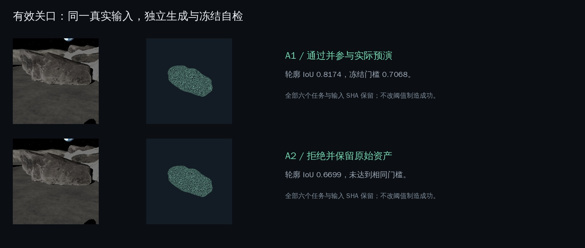
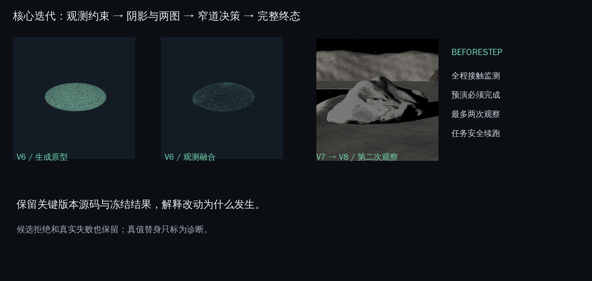
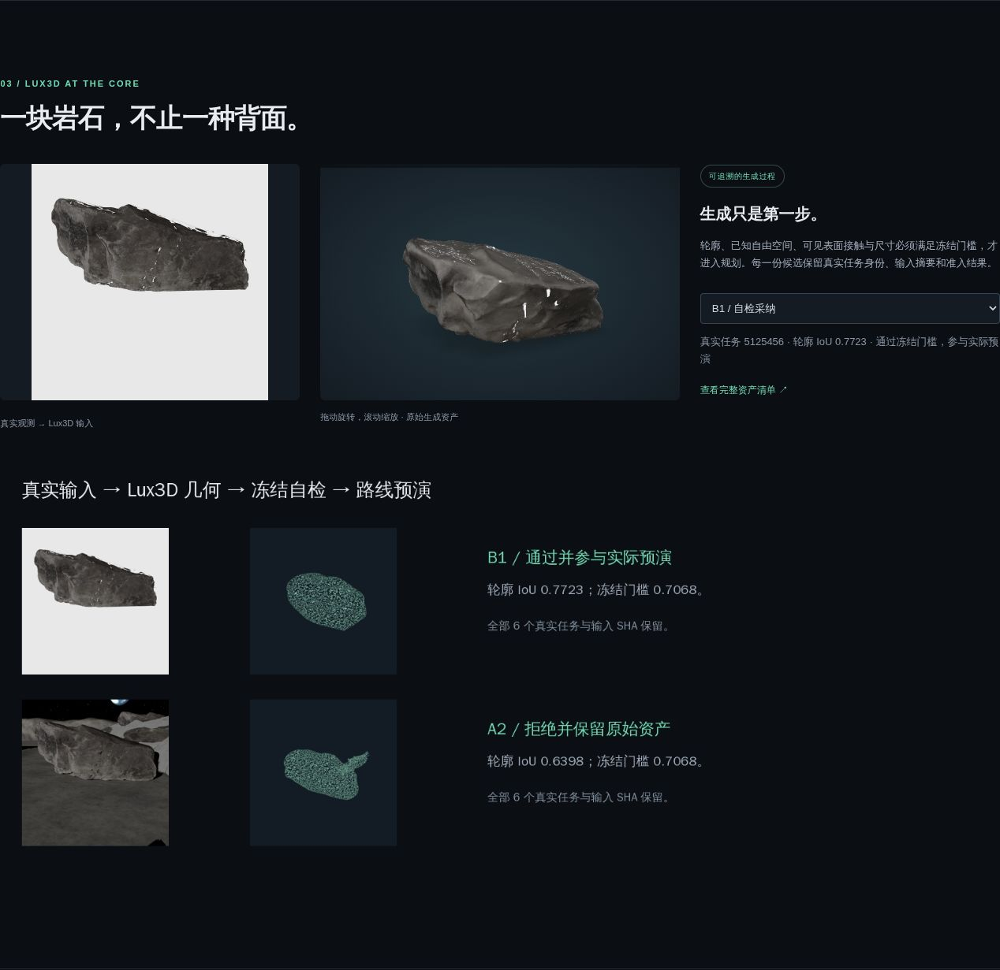

# 先见一步：让机器人在盲区里先想一遍

队伍：**Next Zenith**。参赛工具：**Aholo Lux3D**。项目源代码、完整资产链、技术版本快照、Demo 与运行说明均位于本仓库。

## 创意：看不到的空间，如何决定下一步？

月球南极的低角度阳光使岩石背面落在阴影中。对于轮腿机器人，走过去可能碰撞，把所有未知空间都当作障碍又可能永远停住。我们把生成式 3D 的“想象”变成可检查的候选，并让机器人先在物理世界里尝试。

体验中可以选择直接走、看清再走或想一想再走，观察同一条窄道里的不同决定。评委可以旋转真实生成的岩石，看到输入、被拒原因与机器人轨迹之间的联系。

## Lux3D 如何参与核心流程

1. 同一机器人 RGB-D 相机获得真实观察，亮度低于门槛的阴影不提供有效深度。
2. 目标石头形成三类图像输入：保留光影的紧裁剪、掩码合成、较大上下文。Lux3D 单图生成候选；第二次观察提供真实两图调用。
3. 将原始 GLB 与可见点云配准，只允许刚体与正等比尺度。阴影与遮挡在度量中显式处理。
4. 冻结的尺寸、未知几何占比、可见壳层接触、已知自由空间侵入与轮廓门槛进行自检。
5. 采纳候选形成占据图，加入导航余量；在各候选组合里进行物理预演。
6. 只有预演无碰撞且完成路点才进入独立真值执行；候选不足时选择安全的第二观察，最多两眼，最后保留完整终态。

## 从创意到成果的迭代

V6 用观测约束修复生成几何；V7 处理阴影、两视图与冻结准入；V8 将流程放进南极窄道；BeforeStep 重新按职责组织当前实现，并补齐全程碰撞、终点判定、两眼终态、任务续跑与证据身份。具体问题、改动、资产和局限见 [技术迭代](milestones.md)。

新库精选保存历史证据并提供当前完整源码。未复制无关训练路线、临时阶段脚本和重复运输缓存。每项关键资产都有来源路径、来源提交和内容摘要，原始决策与新版本结果分别保留。

## 真实实验与结果

场景两侧是月溪与岩壁，路内有两块岩石。保守、乐观和想象策略使用同一机器人及真实物理场景。当前结果的权威记录为 `evidence/delivery/results.json`；演示轨迹来自真实运行的 `traj.npz`，完整事件与终态一起保留。

当前规范 Lux3D 分支 **停下 / 两眼 / 52.6s / 无碰撞**，不再请求不存在的第三眼。新增两图批次 **12/12 生成成功、0/12 通过冻结自检**，完整数据与原始资产保留。

| 当前策略 | 结果 | 观察次数 | 仿真时长 |
| --- | --- | --- | --- |
| 直接走 | 碰撞，立即停止 | 1 | 80.94s |
| 看清再走 | 停滞 | 5 | 142.2s |
| Lux3D 想象 | 证据不足，停下 | 2 | 52.6s |

历史 V8 第一块六份候选中 B2、C2 被采纳；第二块第一眼四份成功候选均被拒绝，第二眼三份真实两图候选也均被拒绝。新增 `polar_retry_001` 的 M4–M15 为独立两图采样，保存输入转码原因、任务身份及原始资产；结果仍使用冻结门槛。

乐观策略当前在 80.94s 碰撞时立即停止。旧版 83.44s 包含碰撞后的额外推进，不能作为当前时长。保守策略停滞/5眼/142.2s。真值几何替身曾到达/1眼/115.88s，仅诊断；我们不据此声称 Lux3D 优于基线。

记录观测复现模式使用保留的真实 RGB-D/生成输入，并逐眼核对姿态和仿真时刻。不同渲染环境可能改变少量边缘像素，因此当次实时渲染是独立观察，不声称与历史输入逐字节一致。实时生成模式保留严格输入摘要检查。

## 体验与真实 Demo

- [在线作品页](https://codezzzsleep.github.io/next-zenith-beforestep/)：选择策略、回放真实轨迹、旋转 Lux3D 原始资产、查看版本与资产对比。
- [Demo 视频](../site/media/demo.mp4)：真实 MuJoCo 运行轨迹的三维回放，明确显示各策略、观察次数、终态及流程。
- [运行说明与完整源码](../README.md)：本地页面无需密钥；可重新配准、自检、规划、执行，或新增真实生成。

## 完成度验证与边界

当前核心行为回归覆盖转向/驱动接触即停、已有碰撞不继续 hold、未完成不算到达、已知付费任务不重复创建、不确定创建保留状态、独立样本身份、配准模块隔离、非有限度量拒绝和关键资产摘要。运行资源在全新目录恢复并实际进行 EGL 渲染检查。

这个作品展示可追溯的机器人选择过程。难场景里候选仍可能全部被拒绝，停下也是完整终态；目前没有足够证据证明生成流程普遍优于保守策略。仿真是受控场景，未声称真实机器人部署安全性或月球实机验证。

## 材料与授权

源码按必交标准提供；关键资产、迭代截图、真实视频、报告匹配可运行实现。[第三方来源与许可证](credits.md) 完整保留。传播文案准备见 `submission/xiaohongshu.md`，发布需使用话题 `#Aholo黑客松`。
