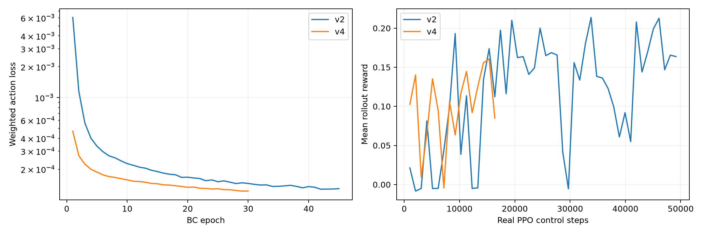
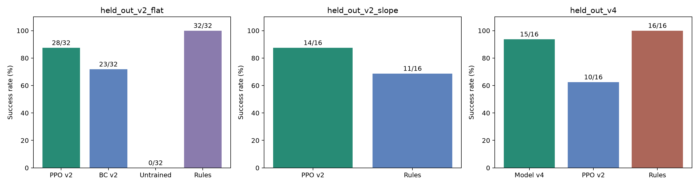
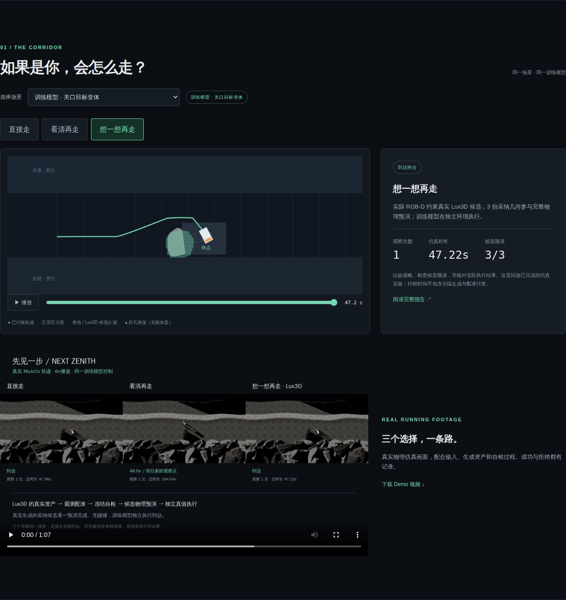
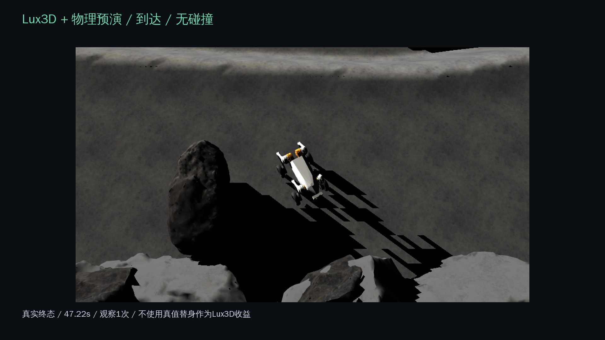

# 先见一步：让机器人在盲区里先想一遍

队伍：Next Zenith。版本：v0.3.0。核心工具：Aholo Lux3D。仓库包含可运行源码、实际训练权重、物理示教、真实生成资产、完整任务记录和 Demo。

## 项目目标与任务

BeforeStep 面向轮腿机器人导航实验，处理遮挡和阴影造成的几何不确定性。机器人只能看到岩石的部分表面，却要决定旁边的路线能否执行。系统用实际 RGB-D 约束 Lux3D 多候选几何，逐份物理预演，再由训练后的控制模型执行，并用独立物理环境的结果核对判断。

主任务从(0,-0.5)出发，在岩壁、月溪和岩石之间到达(5.7,-0.5)。该终点是显式配置的任务变体，用于检查生成几何怎样改变路线；原终点(8.5,0)的成功运行和旧压力场景也完整保留。[项目说明](project.md)给出系统模块与验收范围。

## 机器人控制模型确实经过训练

控制网络读取49维本体状态、相对目标与上一动作，输出4维前后腿姿态残差、前进轮速和差速转向。网络动作通过 PD 伺服推进 MuJoCo 动力学，重力为1.62m/s²。执行不调用规则运动兜底，不用脚本位移替代控制。地图规划、几何准入和候选选择仍是独立模块。

当前部署 v4 行为克隆模型。训练集含128回合、115490个真实物理状态动作，其中57906个来自新增的全角和近目标示教；另外20000行反事实目标监督单独计数。完成30轮行为克隆与16384个真实 PPO 控制步；BC与PPO权重分别保留，任务验收使用固定BC权重。其 SHA256 为 `bd6ca91b73c400ebbfdaed4258f6e2eb20d769468b0d01eba910d16a36f4f970`。

新种子全角与近目标16任务中，v4完成15/16，v2为10/16，规则专家16/16。第一版在关口碰撞；v2大转向失败；v5/v6主动观察姿态仍未通过。这些失败和原训练源码快照均保留。[训练记录](training.md)包含数据、权重、曲线、完整评估与复现命令。

## Lux3D 参与实际决策

1. 机器人从原起点实际运动并停车，获取实时 RGB-D；亮度低于0.10的阴影保持未知。
2. 紧裁剪、掩码、上下文三种输入各独立生成两份候选。原图、必要的 JPEG95 无缩放上传转码、任务身份和输入摘要均保留。
3. 原始 GLB 与可见点云配准，执行冻结的尺寸、未知几何、可见壳层接触、自由空间侵入和轮廓门槛。
4. 采纳几何增加盲区占据，改变规划路线。保留去掉生成占据的参照路线，用相同模型分别预演两条路线。
5. 三份采纳候选均完成选定路线且无碰撞后，在独立扫描几何环境执行并到达。

本轮六个真实云端任务中五份GLB成功、一任务失败。B1/C1/C2轮廓IoU分别为0.7723/0.7861/0.8422，通过冻结门槛0.7068；A1/A2为0.6327/0.6398，被拒绝。原始任务5125347、5125373、5125456、5125485、5125592、5125771及失败身份全部可查。

## 同一场景、观测和训练模型的实测

| 策略 | 实际结果 | 观察次数 | 执行行程 | 候选预演 |
| --- | --- | --- | --- | --- |
| 去掉生成几何 | 到达、无碰撞 | 1 | 46.66s | 无 |
| 保守补充观察 | 3次安全观察点尝试均未满足姿态，未完成 | 1 | 283.44s | 无 |
| Lux3D + 预演 | 到达、无碰撞 | 1 | 46.02s | 3/3完成、无碰撞 |

三组使用相同v4权重、物理场景、终点、起点与首次实时观测；RGB-D和地图摘要逐字节核对。Lux3D主任务独立复跑也到达，原(8.5,0)终点两次实时运行均到达，执行行程54.02s。当前主任务仿真总时间47.22s，含开始记录前1.20s的初始化停稳；执行行程从轨迹起点计算。

加入生成占据后路线确实改变；两条路线各自的三份候选预演都通过。执行后的扫描几何诊断中，规划直行余量由82mm变为120mm。扫描真值未提供给规划器。去掉生成几何也能到达，因此这里证明的是生成几何参与决策和可检查的预演链，不能据此宣称避免了对照碰撞、普遍安全收益或端到端速度优势。行程时间不包括云端生成与配准计算。

保守方法的未完成来自训练模型对观察点姿态的控制限制，不能当成感知策略本身更差的证明。此前(5.4,-0.7)的近岩石目标被采纳候选占据封住，Lux分支停止；同模型不使用生成几何可以到达。该反例说明候选几何也会过于保守。

## 可体验成果与版本保留

[在线体验](https://codezzzsleep.github.io/next-zenith-beforestep/)可切换三策略、检查生成前后路线、旋转五个真实候选并查看拒绝理由。训练页面回放20个实际任务，显示网络动作和独立评估。网页是已完成实验的交互查看入口；新的仿真实验由命令行运行。

[真实主 Demo](../site/media/demo.mp4)展示三策略的物理轨迹和终态；[模型 Demo](../site/media/learning-demo.mp4)展示模型迭代的实际运动。视频按保存的真实状态渲染，标明回放速度。

V6/V7/V8几何与感知迭代、v0.1压力场景、v0.2规则控制成功关口，以及新训练模型各版的源码、配置、输入、生成资产和结果都在本仓库自足保存。[技术迭代](milestones.md)和[场景验收](effective-scene.md)链接这些证据；旧发布标签和附件保持冻结。

## 验证与能力边界

验收核对训练权重身份、相同观测与场景、候选的实际规划作用、完整预演、独立执行与重复结果。行为回归覆盖碰撞即停、未完成不算到达、输入变更拒绝、付费任务恢复与不重复创建、完整训练状态续跑和资产摘要。独立源码包恢复自带资源并实际离屏渲染。

当前成果是受控仿真中的训练控制与盲区推演系统；未验证实机、真实月球部署、通用越障或任意观察姿态。主动观察失败和候选过于保守的反例公开保留，不降低验收阈值制造成功。

[完整源码与运行说明](../README.md) · [第三方许可证与资产来源](credits.md)
