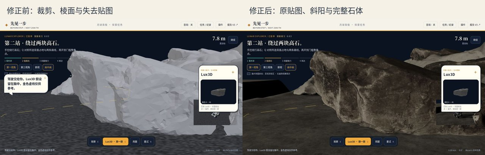

# 完整石体的视觉与交互核对

显示层恢复现有世界包里的两块完整石体，保留原 UV、扫描贴图、月壤与斜阳阴影。
原物理、观测、Lux3D 候选、控制和 V3 保持。方法见[修正说明](../../docs/solid-rocks-20261118.md)，
实际网格、三视角和原交互核对见[verification.json](verification.json)。

前后图来自两个独立的真实键盘操作运行，机器人均在高石前停稳。
它们不是同一个物理帧。修正后的第一、第三、俯视图则来自同一暂停物理状态，
位置、朝向、仿真时刻与动作数逐项相同，没有为截图设置机器人姿态。

- [修正前第一视角](before-first.jpg)
- [完整石体第一视角](after-first.jpg)
- [完整石体第三视角](after-third.jpg)
- [完整石体俯视图](after-overhead.jpg)

实际网页验证包含原始 GLB 转看、默认两个候选碰撞世界完整预演通过、认证路线
出发与 W 键接管。页面及控制台错误均为零。两个实际石体的开放边和非流形边均为
零、方向一致、包围体积为正，连续法线有效。该验证属于本次显示回归，不重跑研究。
